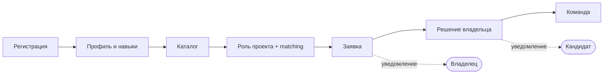

# TeamFinder — документация

**TeamFinder** — веб-сервис для поиска участников и формирования команд для pet-проектов, хакатонов и учебных проектов.

Владелец публикует проект и сразу пишет, кто ему нужен: какие роли, сколько мест, какие навыки обязательны, а какие желательны. Кандидат находит роль, видит, насколько он подходит, и откликается. Владелец принимает или отклоняет заявки и так собирает команду. О каждом шаге обоим приходят уведомления — на сайте и в Telegram. Почта и push появятся к защите.

## Команда и роли

Роли совмещаются. Если за одну роль отвечают двое, ответственный выделен жирным.

| Участник | GitHub | Роли |
|---|---|---|
| Участник 1 | evgeha52 | **Тимлид**, **Backend-разработчик**, **DevOps** |
| Участник 2 | Donpapelone | **Project Manager** (ведёт Kanban-доску), **Database engineer**, **Системный аналитик**, Backend-разработчик (заявки, команда, тесты) |
| Участник 3 | amrrn | **Бизнес-аналитик**, **Frontend-разработчик**, **UX/UI-дизайнер** |

## Макеты

- Figma: https://www.figma.com/design/Q44zk3J1QJNeWsQDKUcoNT (файл «TeamFinder UI v1»)
- Экспорт экранов в PNG: [ui/](ui)
- Описание экранов, состояний и переходов: [ui-design.md](ui-design.md)

Старые варианты макетов в Figma не удаляем — переносим за пределы основного поля или на отдельную страницу «Архив».

## Документы

| Документ | О чём | Владелец |
|---|---|---|
| [business-requirements.md](business-requirements.md) | Проблема, пользователи, цели, границы версий | Участник 3 |
| [teamfinder-v1-requirements.md](teamfinder-v1-requirements.md) | Функциональные требования, состояния, негативные сценарии | Участник 2 |
| [business-rules.md](business-rules.md) | Все бизнес-правила `RULE-*` с кодами ошибок API | Участник 2 |
| [use-cases.md](use-cases.md), [use-case-diagram.md](use-case-diagram.md) | Сценарии UC-01 … UC-18 | Участник 3 |
| [ui-design.md](ui-design.md), [ui/](ui) | Экраны S-01 … S-10, макеты | Участник 3 |
| [architecture-v1.md](architecture-v1.md) | Целевая архитектура: контекст, контейнеры, модули, уведомления | Участник 1 |
| [adr-001-authentication.md](adr-001-authentication.md) | Решение по входу: JWT access + refresh token | Участник 1 |
| [api-contracts-v1.md](api-contracts-v1.md), [openapi.yaml](openapi.yaml) | Контракт API — артефакт, от которого зависят frontend и backend | Участник 1 |
| [erd-v1.md](erd-v1.md) | Модель данных и ограничения БД | Участник 2 |
| [roadmap.md](roadmap.md) | Версии v0.1 → v0.2 → MVP (v0.3, checkpoint 3) → v1.0 и план работ | Участник 1 |
| [git-workflow.md](git-workflow.md) | Ветки `main` / `develop`, процесс PR | Участник 1 |
| [demo-guide.md](demo-guide.md) | Показ на checkpoint 3: запуск с нуля, демо-аккаунты, сценарий, таблица проверки UC | Участник 2 |
| [defense-notes.md](defense-notes.md) | Вопросы преподавателя и ответы: замечания checkpoint 2, негативные кейсы, масштабирование, подводные камни, опыт команды | Все |
| [CHANGELOG.md](CHANGELOG.md) | История изменений: после checkpoint 2 и к checkpoint 3 | Все |

## Основной сценарий

## Репозитории

| Репозиторий | Назначение |
|---|---|
| [teamfinder-docs](https://github.com/TeamFinderProject/teamfinder-docs) | Документация |
| [teamfinder-backend](https://github.com/TeamFinderProject/teamfinder-backend) | ASP.NET Core Web API, PostgreSQL |
| [teamfinder-frontend](https://github.com/TeamFinderProject/teamfinder-frontend) | React SPA |

## Как смотреть контракт в Swagger

- Запустить backend и открыть `http://localhost:5017/swagger`: в списке документов выбрать «Контракт» (этот `openapi.yaml`) или «Реализация» (описание, сгенерированное из кода).
- Без backend: вставить `openapi.yaml` в https://editor.swagger.io.
