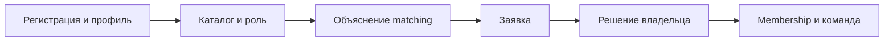

# TeamFinder · Документация

[Организация](https://github.com/TeamFinderProject) · [Backend](https://github.com/TeamFinderProject/teamfinder-backend) · [Frontend](https://github.com/TeamFinderProject/teamfinder-frontend) · [Kanban](https://github.com/orgs/TeamFinderProject/projects/1)

TeamFinder помогает находить участников для pet-проектов, хакатонов и учебных проектов. Владелец задаёт роли, места и требования к навыкам, кандидат видит объяснение соответствия и подаёт заявку на конкретную роль.

Checkpoint 3 защищён. Основная ветка репозиториев — `develop`; дальнейшие исправления проходят через Issues, PR и review. Факт защиты не заменяет проверку отдельных сценариев.

## С чего начать

1. [Запуск и показ приложения](demo-guide.md) — Docker, адреса, демо-аккаунты и порядок проверки.
2. [Архитектура](architecture-v1.md) — модульный монолит и связи между компонентами.
3. [Контракт API](api-contracts-v1.md) и [OpenAPI](openapi.yaml) — запросы, ответы и ошибки.
4. [Roadmap](roadmap.md) — этапы проекта и дальнейший план.

## Документы

| Область | Документы |
|---|---|
| Назначение и требования | [Бизнес-требования](business-requirements.md), [требования v1](teamfinder-v1-requirements.md) |
| Правила и данные | [Бизнес-правила](business-rules.md), [ERD](erd-v1.md) |
| Сценарии | [Use Cases](use-cases.md), [диаграмма сценариев](use-case-diagram.md) |
| Интерфейс | [UI Design](ui-design.md), [экспорты экранов](ui/), [Figma](https://www.figma.com/design/Q44zk3J1QJNeWsQDKUcoNT) |
| API и вход | [API-контракт](api-contracts-v1.md), [OpenAPI](openapi.yaml), [ADR авторизации](adr-001-authentication.md) |
| Разработка | [Архитектура](architecture-v1.md), [Git workflow](git-workflow.md), [Roadmap](roadmap.md), [история изменений](CHANGELOG.md) |
| Демонстрация | [Инструкция запуска](demo-guide.md), [вопросы и ответы](defense-notes.md) |

## Основной сценарий

Application не занимает место; действующий Membership занимает. Принятие заявки закрывает остальные ожидающие заявки кандидата в этом проекте. Matching объясняет совпадение навыков и не принимает решение за владельца. Встроенного чата в v1 нет.

## Текущая команда

| Участник | Ответственность |
|---|---|
| [evgeha52](https://github.com/evgeha52) | Team Lead, backend, DevOps; backend-интеграция, данные и материалы показа после изменения состава команды |
| [amrrn](https://github.com/amrrn) | Frontend, бизнес-анализ, UX/UI; review изменений второго участника |

Авторство ранее сделанных изменений сохраняется в истории Git. Текущего исполнителя конкретной задачи смотрите в Assignees соответствующей Issue.
