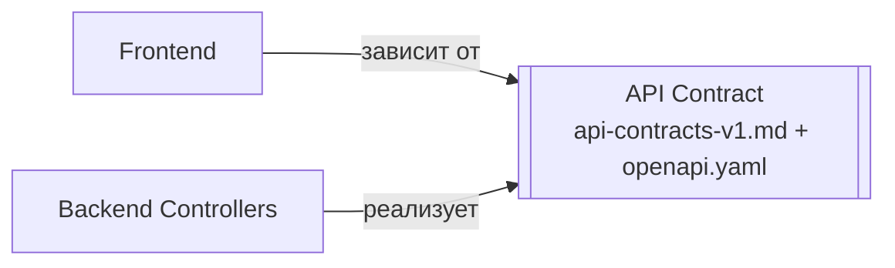
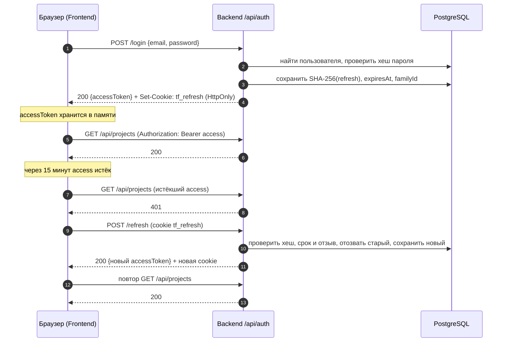
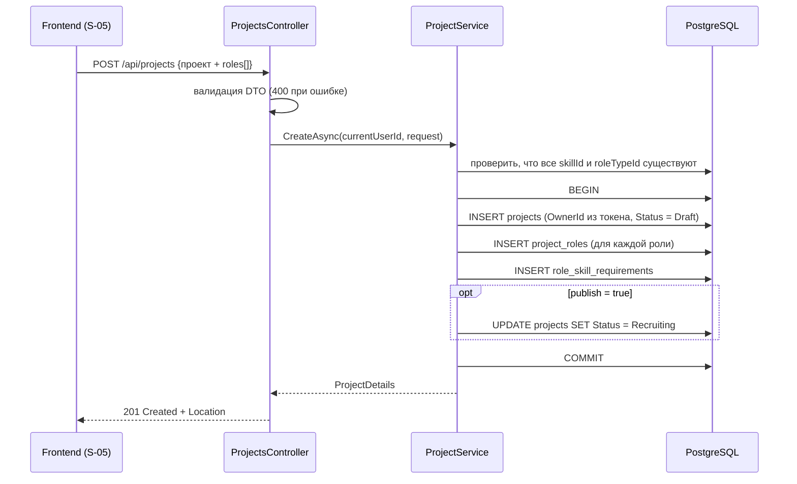
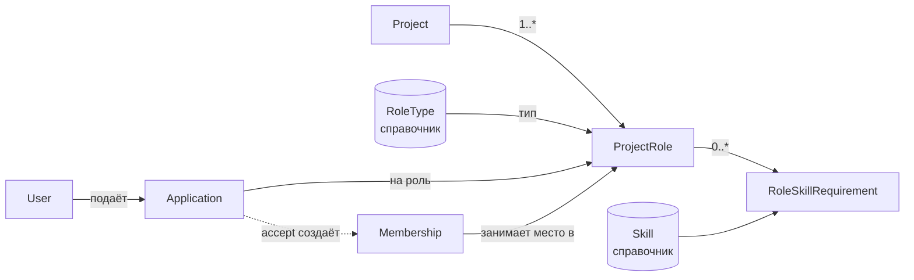
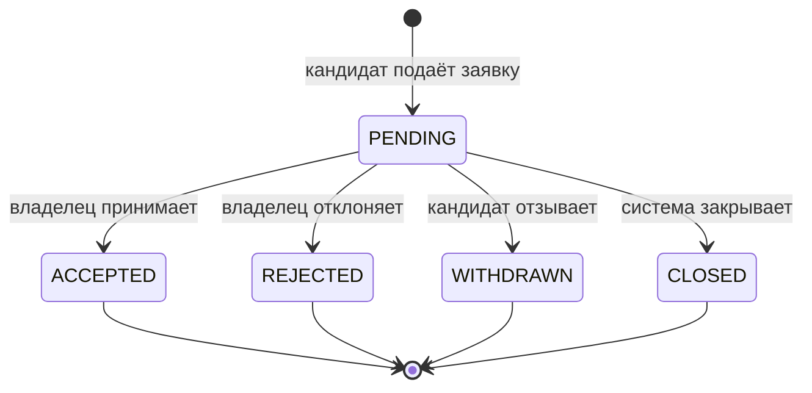
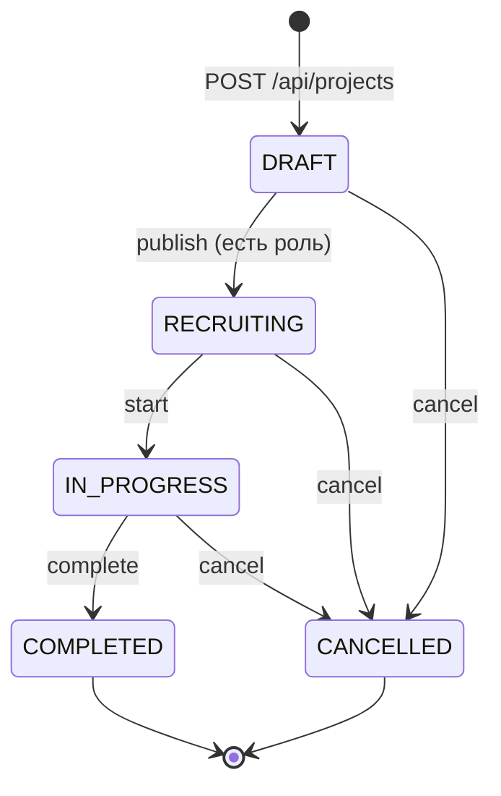
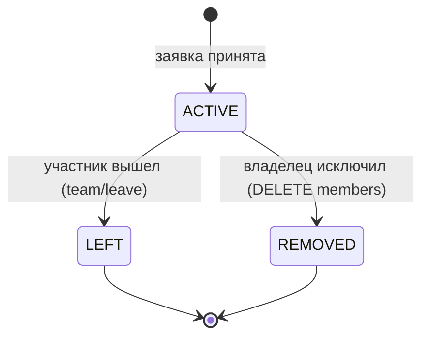

# API Contracts v1

- Версия: 1.1, после checkpoint 2
- Владелец: Участник 1 (Team Lead / Backend)
- Reviewer: Участник 2 (System Analyst), Участник 3 (Frontend)
- Машиночитаемый контракт: [`openapi.yaml`](openapi.yaml) — открывается в Swagger UI
- Связанные документы: [`adr-001-authentication.md`](adr-001-authentication.md), [`business-rules.md`](business-rules.md), [`erd-v1.md`](erd-v1.md), [`ui-design.md`](ui-design.md)

## 1. Назначение

Контракт — это наш артефакт: frontend и backend оба от него зависят. Frontend отправляет запросы так, как здесь описано, backend так их и обрабатывает. Если что-то надо поменять, сначала правим этот документ (через Pull Request в `teamfinder-docs`), а потом код.



То же самое в формате OpenAPI лежит в `openapi.yaml`. Backend показывает его в Swagger UI (`/swagger`, документ «Контракт»), а рядом — описание, которое Swagger строит по коду («Реализация»). Можно открыть оба и сравнить.

## 2. Общие соглашения

### 2.1. Базовый префикс и формат

- Все endpoint'ы начинаются с `/api`.
- Тело запросов и ответов — JSON (`Content-Type: application/json`), имена полей в `camelCase`.
- Значения перечислений передаются строками в `UPPER_SNAKE_CASE`: `PET_PROJECT`, `IN_PROGRESS`, `NICE_TO_HAVE`.
- Даты — строки ISO 8601 в UTC: `2026-10-20T12:30:00Z`.
- Идентификаторы — целые числа (`int64`).

### 2.2. Аутентификация

Защищённые endpoint'ы требуют заголовок:

```http
Authorization: Bearer <accessToken>
```

Подробно — в разделе 3. Текущий пользователь всегда определяется backend из токена. Frontend никогда не передаёт `userId` и `ownerId` для действий от своего имени.

### 2.3. HTTP-коды

| Код | Когда возвращается |
|---|---|
| `200 OK` | Успешный запрос с телом ответа |
| `201 Created` | Создан ресурс. В заголовке `Location` — его адрес |
| `204 No Content` | Действие выполнено, тела нет |
| `400 Bad Request` | Ошибка валидации входных данных |
| `401 Unauthorized` | Нет токена, токен истёк или недействителен |
| `403 Forbidden` | Пользователь аутентифицирован, но прав на действие нет |
| `404 Not Found` | Ресурс не найден |
| `409 Conflict` | Действие противоречит текущему состоянию (бизнес-правило) |
| `429 Too Many Requests` | Слишком много попыток входа с одного адреса |

### 2.4. Формат ошибки

Все ошибки имеют одну структуру:

```json
{
  "code": "ROLE_FULL",
  "message": "Все места на этой роли уже заняты"
}
```

Для ошибок валидации добавляется `errors` — ошибки по полям:

```json
{
  "code": "VALIDATION_ERROR",
  "message": "Некорректные входные данные",
  "errors": {
    "roles[0].capacity": ["Количество мест должно быть от 1 до 50"]
  }
}
```

`code` стабилен, по нему frontend выбирает поведение. `message` — текст для пользователя. Полный перечень кодов — в разделе 14.

### 2.5. Пагинация

Каталог возвращает страницу:

```json
{ "items": [], "page": 1, "pageSize": 20, "total": 57 }
```

Параметры: `page` (с 1, по умолчанию 1), `pageSize` (1–50, по умолчанию 20).

### 2.6. Правила проектирования URL

1. Ресурс адресуется путём. Вложенность пути повторяет принадлежность: роль принадлежит проекту, поэтому `/api/projects/{projectId}/roles/{roleId}`.
2. Фильтры коллекции — в query-параметрах. `GET /api/projects?type=HACKATHON&skillId=3`. Отдельный объект по id получают не фильтром, а путём: `GET /api/projects/42`.
3. Данные для создания и изменения — в теле `POST`, `PUT`, `PATCH`.
4. У `GET` и `DELETE` тела нет. По RFC 9110 (раздел 9.3.5) тело у `DELETE` не имеет определённого смысла: сервер вправе его игнорировать, часть прокси и HTTP-клиентов его отбрасывает, Swagger UI его не отправляет. Поэтому всё, что идентифицирует удаляемый ресурс, передаётся в URL: `DELETE /api/projects/42/members/12`.
5. Действия, которые меняют состояние по правилам, оформлены как `POST /.../{действие}`: `accept`, `reject`, `withdraw`, `publish`, `start`. Это не изменение поля, а переход с проверками и побочными эффектами, поэтому `PATCH { "status": ... }` не используется.

## 3. Механизм аутентификации

Решение и рассмотренные альтернативы — в [`adr-001-authentication.md`](adr-001-authentication.md). Кратко:

| Токен | Что это | Срок жизни | Где хранится на клиенте | Как передаётся |
|---|---|---|---|---|
| Access token | JWT, подпись HMAC-SHA256. Claims: `sub` (id пользователя), `email`, `jti`, `iat`, `exp`, `iss`, `aud` | 15 минут | В памяти приложения (переменная JS), не в `localStorage` | Заголовок `Authorization: Bearer ...` |
| Refresh token | Случайные 256 бит (base64url). В БД хранится только SHA-256 хеш | 14 дней | HttpOnly-cookie `tf_refresh`, `Secure`, `SameSite=Strict`, `Path=/api/auth` | Браузер отправляет cookie сам, JS её не видит |

Правила:

- Ротация. Каждый вызов `POST /api/auth/refresh` отзывает текущий refresh token и выдаёт новый в той же цепочке (`familyId`).
- Обнаружение кражи. Если приходит уже отозванный refresh token, backend отзывает всю цепочку, и пользователю нужно войти заново.
- Logout отзывает текущий refresh token и удаляет cookie. Access token живёт до истечения своих 15 минут, поэтому срок сделан коротким.
- Пароли хранятся только как хеш (PBKDF2 через `PasswordHasher` из ASP.NET Core Identity).
- Флаг `Secure` у cookie включён везде, кроме локальной разработки по `http://localhost` (настройка `Jwt:SecureCookie`), иначе браузер не сохранит cookie без HTTPS.



При перезагрузке страницы access token из памяти теряется, поэтому frontend при старте вызывает `POST /api/auth/refresh`: если cookie жива, сессия восстанавливается без ввода пароля.

## 4. Auth

### Сводка

| Method | Endpoint | Назначение | Доступ |
|---|---|---|---|
| `POST` | `/api/auth/register` | Регистрация и сразу вход | Гость |
| `POST` | `/api/auth/login` | Вход | Гость |
| `POST` | `/api/auth/refresh` | Обновить access token по cookie | Cookie `tf_refresh` |
| `POST` | `/api/auth/logout` | Выход, отзыв refresh token | Cookie `tf_refresh` |
| `GET` | `/api/auth/me` | Кто сейчас вошёл | Авторизованный |

### 4.1. `POST /api/auth/register`

Создаёт пользователя и пустой профиль одной транзакцией, затем сразу выполняет вход (UC-01: после регистрации пользователь авторизован).

| Поле | Тип | Обязательное | Ограничения |
|---|---|:---:|---|
| `email` | string | да | формат email, до 320 символов, уникален без учёта регистра |
| `password` | string | да | 8–128 символов |
| `displayName` | string | да | 2–100 символов |

```json
{ "email": "ivan@example.com", "password": "Secret123!", "displayName": "Иван" }
```

Ответ `201 Created` + `Set-Cookie: tf_refresh=...; HttpOnly; Secure; SameSite=Strict; Path=/api/auth`

```json
{
  "accessToken": "eyJhbGciOiJIUzI1NiIs...",
  "tokenType": "Bearer",
  "expiresIn": 900,
  "user": { "id": 7, "email": "ivan@example.com", "displayName": "Иван" }
}
```

| HTTP | Код | Причина |
|---|---|---|
| `400` | `VALIDATION_ERROR` | Поля не прошли валидацию |
| `409` | `EMAIL_TAKEN` | Email уже зарегистрирован |

### 4.2. `POST /api/auth/login`

```json
{ "email": "ivan@example.com", "password": "Secret123!" }
```

Ответ `200 OK` — такой же, как у регистрации, плюс новая cookie.

| HTTP | Код | Причина |
|---|---|---|
| `400` | `VALIDATION_ERROR` | Пустые поля |
| `401` | `INVALID_CREDENTIALS` | Неверный email или пароль. Какое поле неверно — не уточняется |
| `429` | `TOO_MANY_ATTEMPTS` | Больше 10 попыток входа за минуту с одного IP-адреса (защита от перебора паролей) |

### 4.3. `POST /api/auth/refresh`

Тела нет, refresh token берётся из cookie.

Ответ `200 OK` — новый `accessToken` и новая cookie (старый refresh token отозван).

| HTTP | Код | Причина |
|---|---|---|
| `401` | `INVALID_REFRESH_TOKEN` | Cookie нет, токен истёк, отозван или использован повторно (тогда отзывается вся цепочка) |

Если две вкладки обновляют токен одновременно, вторая приходит со старым токеном, который первая только что заменила. В течение 30 секунд после замены такой токен ещё принимается и выдаётся новый — пользователя не выкидывает. Позже повторное использование считается кражей.

### 4.4. `POST /api/auth/logout`

Тела нет. Отзывает refresh token из cookie и удаляет cookie. Если cookie нет, всё равно возвращается `204`.

Ответ `204 No Content`.

### 4.5. `GET /api/auth/me`

Возвращает пользователя, которому принадлежит access token. Удобно проверить, что токен рабочий, например в Swagger после Authorize. Frontend отдельно его не вызывает: пользователь приходит в ответе `login`, `register` и `refresh`.

```json
{ "id": 7, "email": "ivan@example.com", "displayName": "Иван" }
```

Ошибки: `401 UNAUTHORIZED`.

## 5. Profile

### 5.1. `GET /api/profile`

Профиль текущего пользователя. Доступ: авторизованный.

```json
{
  "id": 7,
  "email": "ivan@example.com",
  "displayName": "Иван",
  "bio": "Backend-разработчик, хочу участвовать в pet-проектах",
  "githubUrl": "https://github.com/ivan",
  "portfolioUrl": null,
  "interestedRoleTypes": [ { "id": 1, "name": "Backend Developer" } ],
  "skills": [ { "skillId": 11, "name": "Go", "level": "INTERMEDIATE" } ]
}
```

### 5.2. `PUT /api/profile`

Сохраняет форму профиля целиком: экран S-02 отправляет всю форму кнопкой «Сохранить». Списки `interestedRoleTypeIds` и `skills` заменяют текущие.

| Поле | Тип | Обязательное | Ограничения |
|---|---|:---:|---|
| `displayName` | string | да | 2–100 символов |
| `bio` | string \| null | нет | до 2000 символов |
| `githubUrl` | string \| null | нет | абсолютный http(s) URL |
| `portfolioUrl` | string \| null | нет | абсолютный http(s) URL |
| `interestedRoleTypeIds` | int64[] | да (может быть пустым) | id из `/api/role-types`, без повторов |
| `skills` | `{ skillId, level }[]` | да (может быть пустым) | id из `/api/skills`, навык не повторяется |

Ответ `200 OK` — обновлённый профиль, как в 5.1.

| HTTP | Код | Причина |
|---|---|---|
| `400` | `VALIDATION_ERROR` | Некорректные поля |
| `400` | `DUPLICATE_SKILL` | Один навык указан дважды |
| `400` | `UNKNOWN_SKILL` / `UNKNOWN_ROLE_TYPE` | Нет такого навыка или типа роли в справочнике |

## 6. Справочники

Справочники наполняет команда (миграция с начальными данными). Пользователи не создают навыки и типы ролей: так в базе не появляются дубликаты вида «C#», «c#», «С Sharp».

| Method | Endpoint | Ответ | Доступ |
|---|---|---|---|
| `GET` | `/api/skills` | `[{ "id": 1, "name": "C#" }, ...]` | Все, включая гостя |
| `GET` | `/api/role-types` | `[{ "id": 1, "name": "Backend Developer" }, ...]` | Все, включая гостя |

## 7. Projects

### Сводка

| Method | Endpoint | Назначение | Доступ |
|---|---|---|---|
| `GET` | `/api/projects` | Каталог с фильтрами | Авторизованный |
| `GET` | `/api/projects/mine` | Мои проекты: где я владелец или участник | Авторизованный |
| `GET` | `/api/projects/{projectId}` | Страница проекта с ролями | Авторизованный |
| `POST` | `/api/projects` | Создать проект вместе с ролями | Авторизованный |
| `PATCH` | `/api/projects/{projectId}` | Изменить поля проекта | Владелец |
| `POST` | `/api/projects/{projectId}/publish` | `DRAFT → RECRUITING` | Владелец |
| `POST` | `/api/projects/{projectId}/start` | `RECRUITING → IN_PROGRESS` | Владелец |
| `POST` | `/api/projects/{projectId}/complete` | `IN_PROGRESS → COMPLETED` | Владелец |
| `POST` | `/api/projects/{projectId}/cancel` | `→ CANCELLED` | Владелец |

Типы проекта: `PET_PROJECT`, `HACKATHON`, `STUDY_PROJECT`. Тип — классификация для фильтра каталога. Поведение системы от типа не зависит, наследования нет.

### 7.1. `GET /api/projects` — каталог

| Параметр | Тип | Описание |
|---|---|---|
| `q` | string | Поиск по названию и описанию |
| `type` | `ProjectType` | Тип проекта |
| `roleTypeId` | int64 | В проекте есть роль этого типа |
| `skillId` | int64 | Хотя бы одна роль требует этот навык |
| `openOnly` | boolean | Только `RECRUITING` и хотя бы одна роль со свободными местами |
| `page`, `pageSize` | int | Пагинация (2.5) |

Черновики (`DRAFT`) в каталоге не показываются. Фильтры комбинируются через «И».

```json
{
  "items": [
    {
      "id": 42,
      "title": "TeamFinder",
      "description": "Сервис поиска участников и формирования команд",
      "type": "STUDY_PROJECT",
      "state": "RECRUITING",
      "owner": { "id": 7, "displayName": "Иван" },
      "roles": [
        { "id": 15, "roleTypeId": 1, "title": "Backend Developer", "capacity": 2, "occupied": 1, "isClosed": false }
      ]
    }
  ],
  "page": 1,
  "pageSize": 20,
  "total": 1
}
```

`GET /api/projects/mine` возвращает массив карточек того же вида, включая черновики владельца, с двумя дополнительными полями: `myRelation` (`OWNER` или `MEMBER`) и `pendingApplications` — сколько заявок ждут решения (только для владельца, у участника `null`). По нему на экране «Мои проекты» видно, где есть новые заявки (BR-26).

### 7.2. `GET /api/projects/{projectId}`

Возвращает проект, его роли и отношение текущего пользователя к проекту. `externalContactUrl` заполнен только для владельца и действующих участников, остальным приходит `null`: контакт виден только команде.

```json
{
  "id": 42,
  "title": "TeamFinder",
  "description": "Сервис поиска участников и формирования команд",
  "type": "STUDY_PROJECT",
  "state": "RECRUITING",
  "externalContactUrl": null,
  "owner": { "id": 7, "displayName": "Иван" },
  "createdAt": "2026-10-20T10:00:00Z",
  "myRelation": "NONE",
  "myApplications": [ { "applicationId": 101, "roleId": 17, "status": "PENDING" } ],
  "roles": [
    {
      "id": 15,
      "roleTypeId": 1,
      "roleTypeName": "Backend Developer",
      "title": "Backend Developer",
      "description": "Реализация API и бизнес-логики",
      "capacity": 2,
      "occupied": 1,
      "isClosed": false,
      "requirementsLocked": true,
      "requirements": [
        { "skillId": 11, "skillName": "Go", "type": "REQUIRED", "minimumLevel": "INTERMEDIATE" },
        { "skillId": 12, "skillName": "Redis", "type": "NICE_TO_HAVE", "minimumLevel": null }
      ]
    }
  ]
}
```

`myRelation`: `OWNER`, `MEMBER` или `NONE`. `requirementsLocked = true`, если на роль уже подавали заявки: тогда тип роли и навыки менять нельзя.

| HTTP | Код | Причина |
|---|---|---|
| `404` | `NOT_FOUND` | Проекта нет, либо это чужой черновик |

### 7.3. `POST /api/projects` — создать проект вместе с ролями

На экране S-05 всё заполняется в одной форме: название, описание, тип, контакт команды и роли с навыками. Кнопка «Создать проект» отправляет один запрос. Backend сохраняет проект, роли и требования к навыкам в одной транзакции — либо сохранится всё, либо ничего. Так не получится проекта, у которого создалась только половина ролей.

Текущий пользователь становится владельцем. Начальное состояние — `DRAFT`. Если передать `"publish": true`, проект после создания сразу переходит в `RECRUITING` (нужна хотя бы одна роль).

Тело запроса

| Поле | Тип | Обязательное | Ограничения |
|---|---|:---:|---|
| `title` | string | да | 3–200 символов |
| `description` | string | да | 10–5000 символов |
| `type` | `ProjectType` | да | `PET_PROJECT`, `HACKATHON`, `STUDY_PROJECT` |
| `externalContactUrl` | string \| null | нет | абсолютный http(s) URL, например `https://t.me/teamfinder_dev` |
| `publish` | boolean | нет | по умолчанию `false` |
| `roles` | `RoleInput[]` | нет | 0–20 ролей. Для `publish: true` — минимум 1 |

`RoleInput` — то же тело, что у `POST /api/projects/{projectId}/roles`:

| Поле | Тип | Обязательное | Ограничения |
|---|---|:---:|---|
| `roleTypeId` | int64 | да | id из `/api/role-types` |
| `title` | string \| null | нет | до 150 символов. Если пусто — берётся название типа роли |
| `description` | string \| null | нет | до 2000 символов |
| `capacity` | int | да | 1–50 |
| `requirements` | `{ skillId, type, minimumLevel }[]` | нет | `type`: `REQUIRED` или `NICE_TO_HAVE`; `minimumLevel` необязателен; навык не повторяется в пределах роли, поэтому не может быть одновременно обязательным и желательным |

```json
{
  "title": "TeamFinder",
  "description": "Сервис поиска участников и формирования команд для учебных проектов",
  "type": "STUDY_PROJECT",
  "externalContactUrl": "https://t.me/teamfinder_dev",
  "publish": false,
  "roles": [
    {
      "roleTypeId": 1,
      "description": "Реализация API и бизнес-логики",
      "capacity": 2,
      "requirements": [
        { "skillId": 1, "type": "REQUIRED", "minimumLevel": "INTERMEDIATE" },
        { "skillId": 3, "type": "REQUIRED", "minimumLevel": "BEGINNER" },
        { "skillId": 9, "type": "NICE_TO_HAVE" }
      ]
    },
    {
      "roleTypeId": 4,
      "title": "UI/UX дизайнер",
      "capacity": 1,
      "requirements": [ { "skillId": 13, "type": "REQUIRED" } ]
    }
  ]
}
```

Ответ `201 Created`, заголовок `Location: /api/projects/42`, тело — как в 7.2.

| HTTP | Код | Причина |
|---|---|---|
| `400` | `VALIDATION_ERROR` | Поля проекта или ролей некорректны (путь поля в `errors`, например `roles[1].capacity`) |
| `400` | `UNKNOWN_SKILL` / `UNKNOWN_ROLE_TYPE` | Ссылка на несуществующую запись справочника |
| `400` | `DUPLICATE_SKILL` | Навык повторяется внутри одной роли |
| `409` | `PROJECT_HAS_NO_ROLES` | `publish: true` без ролей |

Последовательность на backend



### 7.4. `PATCH /api/projects/{projectId}`

Частичное изменение: передаются только изменяемые поля. Роли меняются своими endpoint'ами (раздел 8).

| Поле | Можно менять в состояниях |
|---|---|
| `title`, `description`, `externalContactUrl` | `DRAFT`, `RECRUITING`, `IN_PROGRESS` |
| `type` | только `DRAFT` |

Чтобы очистить `externalContactUrl`, передаётся пустая строка `""`.

Ответ `200 OK` — проект, как в 7.2.

| HTTP | Код | Причина |
|---|---|---|
| `403` | `FORBIDDEN` | Не владелец |
| `409` | `PROJECT_NOT_EDITABLE` | Проект в `COMPLETED` / `CANCELLED`, либо `type` меняется не в `DRAFT` |

### 7.5. Жизненный цикл проекта

| Endpoint | Переход | Проверки | Побочные эффекты |
|---|---|---|---|
| `POST .../publish` | `DRAFT → RECRUITING` | есть хотя бы одна открытая роль | — |
| `POST .../start` | `RECRUITING → IN_PROGRESS` | роли могут быть заполнены не полностью | все `PENDING`-заявки → `CLOSED` (`RECRUITMENT_CLOSED`), участникам уведомление `PROJECT_STARTED` |
| `POST .../complete` | `IN_PROGRESS → COMPLETED` | — | участникам уведомление `PROJECT_COMPLETED` |
| `POST .../cancel` | `DRAFT`, `RECRUITING`, `IN_PROGRESS → CANCELLED` | — | все `PENDING`-заявки → `CLOSED` (`PROJECT_CANCELLED`), уведомление `PROJECT_CANCELLED` |

Ответ `200 OK`: `{ "id": 42, "state": "IN_PROGRESS" }`.

Ошибки: `403 FORBIDDEN`, `404 NOT_FOUND`, `409 INVALID_STATE_TRANSITION`, `409 PROJECT_HAS_NO_ROLES`.

## 8. Project Roles

Роль проекта — позиция в конкретном проекте: сколько мест, какие навыки. Тип роли — запись справочника (`Backend Developer`, `Designer`). Роль проекта всегда ссылается на тип: на этом работают фильтр каталога «Роль» и отметка «роль совпадает с интересующей» в matching.

| Method | Endpoint | Назначение | Доступ |
|---|---|---|---|
| `POST` | `/api/projects/{projectId}/roles` | Добавить роль в существующий проект | Владелец |
| `PATCH` | `/api/projects/{projectId}/roles/{roleId}` | Изменить роль | Владелец |
| `POST` | `/api/projects/{projectId}/roles/{roleId}/close` | Закрыть набор на роль | Владелец |
| `DELETE` | `/api/projects/{projectId}/roles/{roleId}` | Удалить роль без заявок | Владелец |
| `GET` | `/api/projects/{projectId}/roles/{roleId}/match` | Matching текущего пользователя | Авторизованный |

### 8.1. `POST /api/projects/{projectId}/roles`

Тело — `RoleInput` из 7.3. Разрешено в `DRAFT` и `RECRUITING`, иначе `409 PROJECT_NOT_EDITABLE`. Ответ `201 Created` — роль, как элемент `roles` в 7.2.

### 8.2. `PATCH /api/projects/{projectId}/roles/{roleId}`

Передаются только изменяемые поля: `title`, `description`, `capacity`, `roleTypeId`, `requirements` (массив заменяет текущий).

| Поле | Ограничение |
|---|---|
| `title`, `description` | всегда, пока проект не завершён и не отменён |
| `capacity` | не меньше числа действующих участников роли (`CAPACITY_BELOW_OCCUPIED`) |
| `roleTypeId`, `requirements` | только пока на роль не подано ни одной заявки (`ROLE_LOCKED`). Иначе кандидат подался на одни требования, а оценивать его будут по другим |

Если после уменьшения `capacity` свободных мест не осталось, ожидающие заявки на роль закрываются с причиной `ROLE_FILLED`.

### 8.3. `POST /api/projects/{projectId}/roles/{roleId}/close`

Закрывает набор на роль (кнопка «Закрыть роль» на S-06). Новые заявки на неё не принимаются, `PENDING`-заявки → `CLOSED` (`ROLE_CLOSED`). Действующие участники роли остаются. Ответ `200 OK` — роль.

### 8.4. `DELETE /api/projects/{projectId}/roles/{roleId}`

Удаляет роль, только если на неё не подавали заявок и в ней нет участников. Иначе `409 ROLE_HAS_APPLICATIONS`: роль нужно закрыть (8.3), чтобы не потерять историю. Ответ `204 No Content`.

### 8.5. `GET /api/projects/{projectId}/roles/{roleId}/match`

Сравнивает навыки текущего пользователя с требованиями роли. Результат рекомендательный и ни на что не влияет автоматически. Процент не считается.

```json
{
  "roleId": 15,
  "profileHasSkills": true,
  "roleTypeMatchesInterest": true,
  "required": [
    { "skillId": 11, "skill": "Go", "minimumLevel": "INTERMEDIATE", "userLevel": "INTERMEDIATE", "status": "MATCHED" },
    { "skillId": 3, "skill": "PostgreSQL", "minimumLevel": "BEGINNER", "userLevel": null, "status": "MISSING" }
  ],
  "niceToHave": [
    { "skillId": 12, "skill": "Redis", "minimumLevel": null, "userLevel": "BEGINNER", "status": "MATCHED" }
  ],
  "summary": { "requiredMatched": 1, "requiredTotal": 2, "niceToHaveMatched": 1, "niceToHaveTotal": 1 }
}
```

`status`: `MATCHED` — навык есть и уровень не ниже минимального; `LEVEL_TOO_LOW` — навык есть, но уровень ниже; `MISSING` — навыка нет. Если у пользователя нет ни одного навыка, `profileHasSkills = false`, и интерфейс предлагает заполнить профиль.

## 9. Связь сущностей в API



## 10. Applications

| Method | Endpoint | Назначение | Доступ |
|---|---|---|---|
| `POST` | `/api/projects/{projectId}/roles/{roleId}/applications` | Подать заявку на роль проекта | Авторизованный, не владелец |
| `GET` | `/api/applications/mine` | Мои заявки | Авторизованный |
| `POST` | `/api/applications/{applicationId}/withdraw` | Отозвать | Автор заявки |
| `GET` | `/api/projects/{projectId}/applications` | Заявки проекта | Владелец |
| `POST` | `/api/applications/{applicationId}/accept` | Принять | Владелец проекта |
| `POST` | `/api/applications/{applicationId}/reject` | Отклонить | Владелец проекта |

После создания заявка — самостоятельный ресурс со своим `id`, поэтому действия над ней адресуются как `/api/applications/{applicationId}/...`. Проект и роль backend берёт из самой заявки, клиенту их передавать не нужно.

### 10.1. Подать заявку

`POST /api/projects/{projectId}/roles/{roleId}/applications`

Заявка подаётся на конкретную роль конкретного проекта. Роль всегда принадлежит одному проекту, поэтому `{projectId, roleId}` однозначно указывает, куда человек откликается. Если `roleId` не из этого проекта, backend вернёт `404`.

```json
{ "message": "Есть опыт с Go и PostgreSQL, хочу заниматься backend." }
```

| Поле | Тип | Обязательное | Ограничения |
|---|---|:---:|---|
| `message` | string \| null | нет | до 1000 символов |

Ответ `201 Created`

```json
{
  "id": 101,
  "projectId": 42,
  "roleId": 15,
  "status": "PENDING",
  "closeReason": null,
  "message": "Есть опыт с Go и PostgreSQL, хочу заниматься backend.",
  "createdAt": "2026-10-20T12:00:00Z",
  "decidedAt": null,
  "membershipId": null
}
```

Проверки выполняются на сервере, отключённая кнопка в UI их не заменяет:

| Условие | Ошибка, если не выполнено |
|---|---|
| Проект в `RECRUITING` | `409 PROJECT_NOT_RECRUITING` |
| Роль не закрыта | `409 ROLE_CLOSED` |
| На роли есть свободное место | `409 ROLE_FULL` |
| Заявитель не владелец проекта | `409 OWNER_CANNOT_APPLY` |
| Заявитель никогда не состоял в команде этого проекта (в v1 вернуться после выхода или исключения нельзя, RULE-TEAM-05) | `409 ALREADY_MEMBER` |
| На эту роль от пользователя ещё не было заявки (в любом статусе) | `409 DUPLICATE_APPLICATION` |

На разные роли одного проекта подаваться можно. Подача заявки места не занимает. Отсутствие required-навыков подачу не запрещает. Владелец проекта получает уведомление `APPLICATION_RECEIVED`.

### 10.2. `GET /api/applications/mine`

```json
[
  {
    "id": 101,
    "project": { "id": 42, "title": "TeamFinder", "state": "RECRUITING" },
    "role": { "id": 15, "title": "Backend Developer" },
    "status": "PENDING",
    "closeReason": null,
    "message": "Есть опыт с Go и PostgreSQL",
    "createdAt": "2026-10-20T12:00:00Z",
    "decidedAt": null,
    "canWithdraw": true
  }
]
```

### 10.3. `POST /api/applications/{applicationId}/withdraw`

Когда можно отозвать: только пока заявка в статусе `PENDING`, то есть до решения владельца.

- После `ACCEPTED` кандидат уже в команде. Отзывать нечего: он выходит из команды через `POST /api/projects/{projectId}/team/leave`.
- `REJECTED` и `CLOSED` — уже конечные состояния.
- Состояние проекта отдельно не проверяется: `PENDING`-заявка бывает только в `RECRUITING`, при переходе проекта дальше она закрывается автоматически.

Ответ `200 OK` — заявка (как в 10.1) со статусом `WITHDRAWN`.

| HTTP | Код | Причина |
|---|---|---|
| `403` | `FORBIDDEN` | Заявка чужая |
| `409` | `APPLICATION_NOT_PENDING` | Заявка уже не в `PENDING` |

### 10.4. `GET /api/projects/{projectId}/applications`

Параметры: `status` и `roleId` — необязательные фильтры. Владелец видит кандидата и результат matching, чтобы сравнивать кандидатов по навыкам, а не по тексту сообщения.

```json
[
  {
    "id": 101,
    "roleId": 15,
    "roleTitle": "Backend Developer",
    "status": "PENDING",
    "closeReason": null,
    "message": "Есть опыт с Go и PostgreSQL",
    "createdAt": "2026-10-20T12:00:00Z",
    "decidedAt": null,
    "candidate": {
      "id": 12,
      "displayName": "Пётр",
      "bio": "Пишу на Go 2 года",
      "githubUrl": "https://github.com/petr",
      "skills": [ { "skillId": 11, "name": "Go", "level": "INTERMEDIATE" } ],
      "interestedRoleTypes": [ { "id": 1, "name": "Backend Developer" } ]
    },
    "match": { "requiredMatched": 2, "requiredTotal": 2, "niceToHaveMatched": 1, "niceToHaveTotal": 2 }
  }
]
```

### 10.5. `POST /api/applications/{applicationId}/accept`

Всё делается в одной транзакции. В начале backend блокирует строку проекта (`SELECT ... FOR UPDATE`), и все операции над заявками и командой этого проекта идут по очереди. Если два запроса одновременно пытаются занять последнее место, первый его займёт, а второй получит `409`: его заявка к этому моменту уже закрыта (`ROLE_FILLED`) или мест нет.

1. Проверить: текущий пользователь — владелец, проект в `RECRUITING`, заявка в `PENDING`, роль не закрыта, есть свободное место, кандидат ещё не участник проекта.
2. Заявка → `ACCEPTED`, `decidedAt = now`.
3. Создать `Membership` (пользователь, проект, роль).
4. Другие `PENDING`-заявки этого кандидата в этом проекте → `CLOSED` (`ACCEPTED_ANOTHER_ROLE`).
5. Если роль заполнена, `PENDING`-заявки других кандидатов на эту роль → `CLOSED` (`ROLE_FILLED`).
6. Уведомления: кандидату `APPLICATION_ACCEPTED`, авторам закрытых заявок `APPLICATION_CLOSED`.

Ответ `200 OK` — заявка со статусом `ACCEPTED` и заполненным `membershipId`.

| HTTP | Код | Причина |
|---|---|---|
| `403` | `FORBIDDEN` | Не владелец проекта |
| `409` | `APPLICATION_NOT_PENDING` | Заявка уже обработана. Повторный запрос не создаёт второе участие |
| `409` | `PROJECT_NOT_RECRUITING` | Набор закрыт |
| `409` | `ROLE_FULL` | Мест нет |
| `409` | `ALREADY_MEMBER` | Кандидат уже в команде |

### 10.6. `POST /api/applications/{applicationId}/reject`

Заявка `PENDING` → `REJECTED`. Кандидат получает уведомление `APPLICATION_REJECTED`. Ответ `200 OK` — заявка.

Ошибки: `403 FORBIDDEN`, `404 NOT_FOUND`, `409 APPLICATION_NOT_PENDING`.

## 11. Team

| Method | Endpoint | Назначение | Доступ |
|---|---|---|---|
| `GET` | `/api/projects/{projectId}/team` | Состав команды и контакт | Владелец или действующий участник |
| `POST` | `/api/projects/{projectId}/team/leave` | Выйти из команды | Действующий участник |
| `DELETE` | `/api/projects/{projectId}/members/{userId}` | Исключить участника | Владелец |

### 11.1. `GET /api/projects/{projectId}/team`

```json
{
  "project": { "id": 42, "title": "TeamFinder", "type": "STUDY_PROJECT", "state": "IN_PROGRESS" },
  "owner": { "id": 7, "displayName": "Иван" },
  "externalContactUrl": "https://t.me/teamfinder_dev",
  "members": [
    { "membershipId": 55, "userId": 12, "displayName": "Пётр", "roleId": 15, "roleTitle": "Backend Developer", "joinedAt": "2026-10-21T09:00:00Z" }
  ]
}
```

Владелец не входит в `members` и место в роли не занимает.

### 11.2. `POST /api/projects/{projectId}/team/leave`

Участие завершается: `endedAt = now`, `endReason = LEFT`. Запись не удаляется, это история. Место в роли освобождается. Владелец получает уведомление `MEMBER_LEFT`. Ответ `204`. Ошибки: `409 NOT_A_MEMBER`, `409 PROJECT_NOT_EDITABLE` (проект завершён или отменён).

### 11.3. `DELETE /api/projects/{projectId}/members/{userId}`

Владелец исключает участника: `endedAt = now`, `endReason = REMOVED`. Участник получает уведомление `MEMBER_REMOVED`. Ответ `204`.

Почему `projectId` и `userId` в URL, а не в теле запроса. Участник команды — это часть проекта, и `/api/projects/42/members/12` — его адрес. `DELETE` удаляет то, что лежит по адресу, а адрес целиком задаётся в URL. Тело у `DELETE` по стандарту (RFC 9110) ничего не значит: сервер может его проигнорировать, а прокси и некоторые клиенты, включая Swagger UI, вообще его не отправляют. Если перенести id в тело, запрос может дойти до сервера уже без них. Плюс по пути сразу видно, к какому проекту запрос, и проверить, владелец ли это, можно до чтения тела.

Ошибки: `403 FORBIDDEN`, `404 NOT_FOUND` (нет действующего участия), `409 PROJECT_NOT_EDITABLE`.

## 12. Notifications

Уведомления создаются при каждом событии (новая заявка, решение, закрытие, выход, исключение, смена состояния проекта). В MVP их видно на сайте и они приходят в Telegram, если пользователь подключил бота. Почта и push — к v1.0 через тот же модуль (см. [`architecture-v1.md`](architecture-v1.md)).

| Method | Endpoint | Назначение |
|---|---|---|
| `GET` | `/api/notifications?unreadOnly=true` | Мои уведомления, новые сверху (до 50) |
| `POST` | `/api/notifications/{notificationId}/read` | Отметить прочитанным, `204` |
| `POST` | `/api/notifications/read-all` | Отметить все прочитанными, `204` |

```json
[
  {
    "id": 3,
    "type": "APPLICATION_ACCEPTED",
    "text": "Вас приняли в проект «TeamFinder» на роль Backend Developer",
    "projectId": 42,
    "createdAt": "2026-10-21T09:00:00Z",
    "isRead": false
  }
]
```

Типы: `APPLICATION_RECEIVED`, `APPLICATION_ACCEPTED`, `APPLICATION_REJECTED`, `APPLICATION_CLOSED`, `MEMBER_LEFT`, `MEMBER_REMOVED`, `PROJECT_STARTED`, `PROJECT_COMPLETED`, `PROJECT_CANCELLED`.

### 12.1. Telegram

| Method | Endpoint | Назначение |
|---|---|---|
| `GET` | `/api/profile/telegram` | Подключён ли Telegram |
| `POST` | `/api/profile/telegram/link` | Получить одноразовую ссылку на бота |
| `DELETE` | `/api/profile/telegram` | Отключить Telegram |

Как подключается:

1. В профиле пользователь нажимает «Подключить Telegram», frontend вызывает `POST /api/profile/telegram/link`.
2. Backend создаёт одноразовый код на 10 минут и возвращает ссылку:

```json
{ "code": "q3Jx9vT2cKpL0aZw", "url": "https://t.me/teamfinder_demo_bot?start=q3Jx9vT2cKpL0aZw", "expiresAt": "2026-10-29T12:10:00Z" }
```

3. Пользователь открывает ссылку и нажимает Start. Бот получает сообщение `/start q3Jx9vT2cKpL0aZw`, backend находит по коду пользователя и запоминает `chat_id`.
4. С этого момента новые уведомления этого пользователя уходят и в Telegram. Команда `/stop` в чате с ботом отключает их.

`GET /api/profile/telegram`:

```json
{ "enabled": true, "linked": true, "botUsername": "teamfinder_demo_bot", "linkedAt": "2026-10-29T12:03:00Z" }
```

`enabled = false` значит, что бот не настроен на сервере (нет `Telegram:BotToken`). Тогда `POST .../link` отвечает `409 TELEGRAM_DISABLED`, а уведомления видны только на сайте.

`DELETE /api/profile/telegram` — тела нет, отключается Telegram текущего пользователя. Ответ `204`.

## 13. Состояния и переходы

### 13.1. Заявка (`Application.status`)



| Из | Действие | Кто | В | Условия |
|---|---|---|---|---|
| — | `POST .../applications` | Кандидат | `PENDING` | 10.1 |
| `PENDING` | `accept` | Владелец | `ACCEPTED` | проект `RECRUITING`, есть место, кандидат не участник |
| `PENDING` | `reject` | Владелец | `REJECTED` | — |
| `PENDING` | `withdraw` | Автор заявки | `WITHDRAWN` | — |
| `PENDING` | принят на другую роль проекта | Система | `CLOSED` (`ACCEPTED_ANOTHER_ROLE`) | — |
| `PENDING` | роль заполнилась | Система | `CLOSED` (`ROLE_FILLED`) | — |
| `PENDING` | владелец закрыл роль | Система | `CLOSED` (`ROLE_CLOSED`) | — |
| `PENDING` | проект переведён в работу | Система | `CLOSED` (`RECRUITMENT_CLOSED`) | — |
| `PENDING` | проект отменён | Система | `CLOSED` (`PROJECT_CANCELLED`) | — |
| `ACCEPTED`, `REJECTED`, `WITHDRAWN`, `CLOSED` | любое действие | — | без изменений | `409 APPLICATION_NOT_PENDING` |

Конечные состояния не возвращаются в `PENDING`. Повторная заявка на ту же роль в v1 запрещена (`DUPLICATE_APPLICATION`).

### 13.2. Проект (`Project.state`)



### 13.3. Участие (`Membership`)



Запись участия не удаляется: `endedAt` и `endReason` сохраняют историю. Место занимают только активные участия (`endedAt IS NULL`).

### 13.4. Перечисления

| Тип | Значения |
|---|---|
| `ProjectType` | `PET_PROJECT`, `HACKATHON`, `STUDY_PROJECT` |
| `ProjectState` | `DRAFT`, `RECRUITING`, `IN_PROGRESS`, `COMPLETED`, `CANCELLED` |
| `ApplicationStatus` | `PENDING`, `ACCEPTED`, `REJECTED`, `WITHDRAWN`, `CLOSED` |
| `ApplicationCloseReason` | `ACCEPTED_ANOTHER_ROLE`, `ROLE_FILLED`, `ROLE_CLOSED`, `RECRUITMENT_CLOSED`, `PROJECT_CANCELLED` |
| `SkillLevel` | `BEGINNER`, `INTERMEDIATE`, `ADVANCED` |
| `RequirementType` | `REQUIRED`, `NICE_TO_HAVE` |
| `MembershipEndReason` | `LEFT`, `REMOVED` |

## 14. Коды ошибок

| Код | HTTP | Когда |
|---|---|---|
| `VALIDATION_ERROR` | 400 | Поля запроса не прошли валидацию |
| `DUPLICATE_SKILL` | 400 | Навык повторяется в профиле или в роли |
| `UNKNOWN_SKILL` | 400 | Нет навыка в справочнике |
| `UNKNOWN_ROLE_TYPE` | 400 | Нет типа роли в справочнике |
| `UNAUTHORIZED` | 401 | Нет или истёк access token |
| `INVALID_CREDENTIALS` | 401 | Неверный email или пароль |
| `INVALID_REFRESH_TOKEN` | 401 | Refresh token отсутствует, истёк или отозван |
| `FORBIDDEN` | 403 | Нет прав на действие |
| `NOT_FOUND` | 404 | Ресурс не найден |
| `EMAIL_TAKEN` | 409 | Email уже занят |
| `PROJECT_NOT_EDITABLE` | 409 | Проект в конечном состоянии, или поле нельзя менять в текущем |
| `INVALID_STATE_TRANSITION` | 409 | Недопустимый переход проекта |
| `PROJECT_HAS_NO_ROLES` | 409 | Публикация без ролей |
| `PROJECT_NOT_RECRUITING` | 409 | Подача или принятие вне набора |
| `ROLE_FULL` | 409 | Нет свободных мест |
| `ROLE_CLOSED` | 409 | Набор на роль закрыт |
| `ROLE_LOCKED` | 409 | Тип и навыки роли нельзя менять после первой заявки |
| `CAPACITY_BELOW_OCCUPIED` | 409 | Мест меньше, чем участников |
| `ROLE_HAS_APPLICATIONS` | 409 | Роль с заявками нельзя удалить, только закрыть |
| `DUPLICATE_APPLICATION` | 409 | Заявка на эту роль уже была |
| `ALREADY_MEMBER` | 409 | Пользователь уже в команде проекта |
| `OWNER_CANNOT_APPLY` | 409 | Владелец подаёт заявку в свой проект |
| `APPLICATION_NOT_PENDING` | 409 | Действие над уже обработанной заявкой |
| `NOT_A_MEMBER` | 409 | Выход из команды, в которой пользователь не состоит |
| `TELEGRAM_DISABLED` | 409 | Telegram-бот не настроен на сервере |
| `TOO_MANY_ATTEMPTS` | 429 | Слишком много попыток входа за минуту |
| `CONFLICT` | 409 | Запись уже существует: редкая гонка, которую поймало ограничение уникальности БД. Нужно обновить данные и повторить |
| `INTERNAL_ERROR` | 500 | Непредвиденная ошибка сервера; детали пишутся в лог, клиенту не показываются |

## 15. Что не входит в контракт v1

| Возможность | Когда |
|---|---|
| Email и push-уведомления, настройки «какие события присылать» | v1.0 (защита), через модуль Notifications |
| Встроенный чат | Не планируется: связь через внешний контакт |
| ML-рекомендации, процент соответствия | После v1 |
| Повторное открытие набора, передача владения | После v1 |
| Восстановление и смена пароля, смена email | Не в MVP. Можно сделать вместе с почтовыми уведомлениями в v1.0 |
