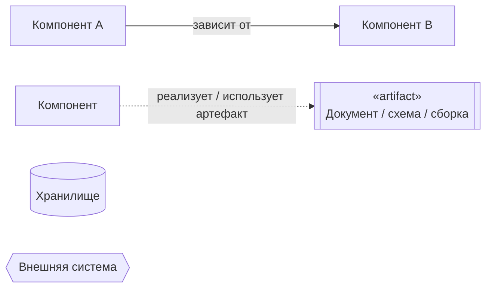
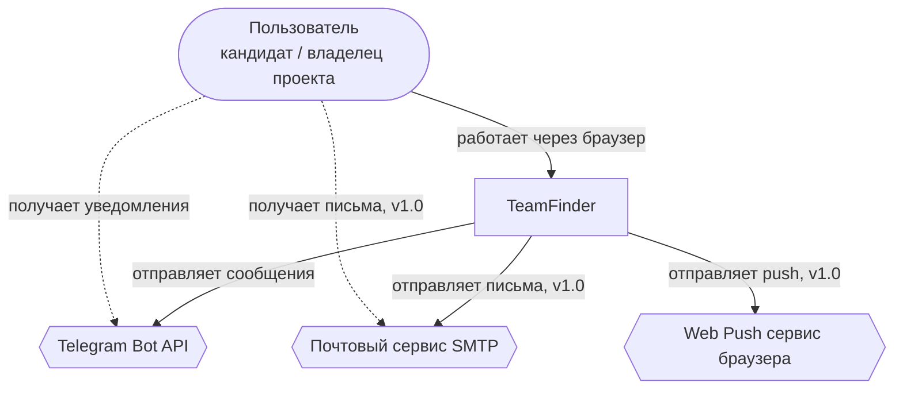
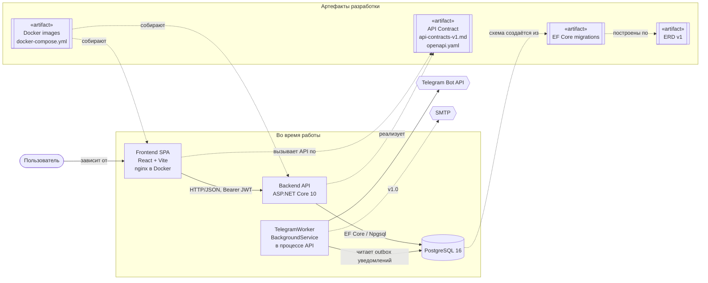
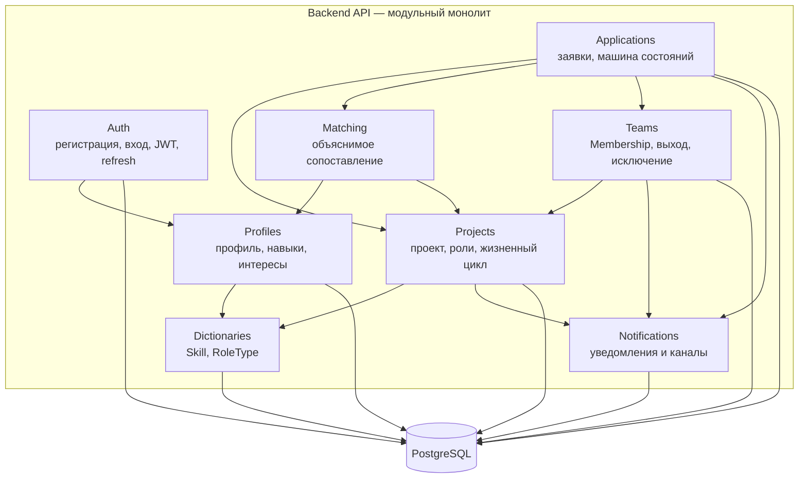
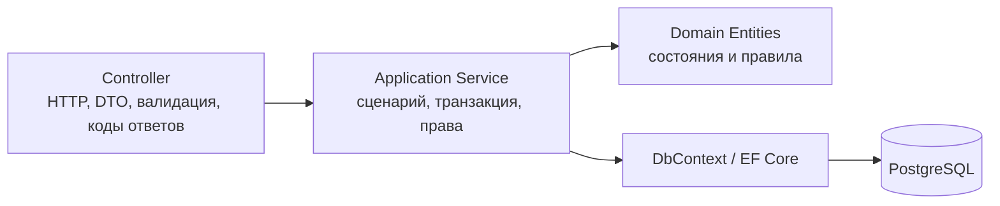
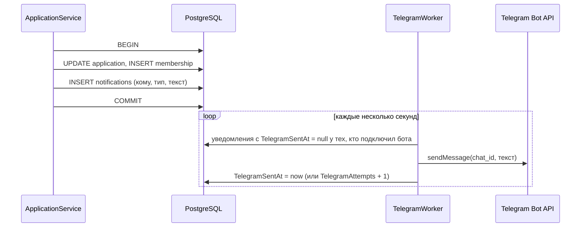
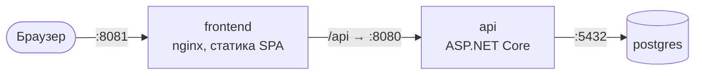

# Architecture v1

- Версия: 1.1, после checkpoint 2
- Владелец: Участник 1 (Team Lead / Backend / DevOps)
- Reviewer: Участник 2 (System Analyst)
- Схемы нарисованы на Mermaid прямо в тексте, GitHub показывает их как картинки. Старую схему из Excalidraw убрали, чтобы не было двух разных версий

## 1. Архитектурный стиль

Мы делаем модульный монолит: одно backend-приложение на ASP.NET Core, а внутри него код разложен по модулям (пользователи, проекты, заявки и т. д.). Микросервисы нам не нужны — нас трое, база одна, нагрузка учебная. Но если когда-нибудь понадобится, например, вынести уведомления отдельно, это будет несложно, потому что модуль уже отделён.

Внутри модуля код разбит на слои: Controller → Service → сущности → EF Core. Контроллер принимает HTTP-запрос и вызывает сервис, а все проверки и правила лежат в сервисе. CQRS мы не используем: читаем и пишем через одну и ту же модель, отдельные модели для чтения при нашей нагрузке ничего не дадут.

## 2. Нотация

- Сплошная стрелка `A → B`: A зависит от B (вызывает его, без B не работает).
- Пунктирная стрелка к артефакту: компонент построен по артефакту или использует его.
- Двойная рамка — артефакт, то есть то, что мы производим в процессе разработки: контракт API, ERD, миграции, Docker-образ. Во время работы системы артефакт ничего не делает, от него зависят на этапе разработки.

## 3. Контекст системы (уровень 1)

Основной сценарий: владелец публикует проект с ролями, кандидат находит подходящую роль и откликается, владелец принимает или отклоняет. Telegram, почта и push нужны, чтобы люди сразу узнавали о новой заявке или о решении по ней, а не заходили на сайт проверять. Без этого сервис мало отличается от доски объявлений.

## 4. Контейнеры и артефакты (уровень 2)

| Элемент | Тип | Ответственность |
|---|---|---|
| Frontend SPA | компонент | Экраны S-01…S-10, хранит access token в памяти и обновляет его по refresh-cookie |
| Backend API | компонент | HTTP API по контракту, аутентификация, бизнес-правила, транзакции |
| TelegramWorker | компонент | Фоновая задача в процессе API: читает сообщения боту (`/start`, `/stop`) и отправляет в Telegram уведомления, которые ещё не ушли, до 5 попыток. К v1.0 к ней добавятся почта и push |
| PostgreSQL | хранилище | Все данные, включая refresh-токены и очередь уведомлений |
| API Contract | артефакт | Соглашение frontend ↔ backend. Swagger UI backend показывает его рядом со сгенерированным из кода описанием |
| ERD, migrations | артефакты | Модель данных и версии схемы БД |
| Docker images | артефакт | Воспроизводимый запуск: `docker compose up` |

## 5. Модули backend и их зависимости (уровень 3)

Как мы договорились про зависимости:

- заявки зависят от проектов, а проекты от заявок — нет;
- модуль уведомлений ни от кого не зависит, остальные модули только добавляют в него записи. Поэтому Telegram или почту можно подключить, не трогая код заявок и проектов;
- циклов между модулями нет. Когда при отмене проекта нужно закрыть заявки, сервис проекта делает это сам в своей транзакции, а не вызывает сервис заявок.

## 6. Слои внутри модуля и путь запроса

Для примера — что происходит, когда владелец принимает заявку (`POST /api/applications/{id}/accept`):

1. `ApplicationsController` берёт `userId` из JWT и вызывает `ApplicationService.AcceptAsync`.
2. Сервис открывает транзакцию и блокирует строку проекта (`SELECT ... FOR UPDATE`). Ту же блокировку берут подача, отзыв, отклонение, смена состояния проекта, выход и исключение, поэтому операции одного проекта не пересекаются.
3. Проверяет правила: владелец, проект в `RECRUITING`, заявка `PENDING`, есть место.
4. Меняет статусы, создаёт `Membership`, закрывает лишние заявки, добавляет записи уведомлений.
5. Делает `COMMIT` и возвращает `200`. Во внешние каналы уведомления уйдут потом, фоновой задачей, пользователь этого не ждёт.

## 7. Уведомления

Уведомления — основная причина возвращаться в сервис: владелец должен сразу узнать о новой заявке, кандидат — о решении. Поэтому модуль сразу рассчитан на несколько каналов.

Уведомление записывается в базу в той же транзакции, что и само событие (такой приём называют transactional outbox). Если транзакция откатилась — уведомления тоже нет. Если Telegram в этот момент недоступен — данные всё равно сохранены, а отправка повторится позже.

Каналы:

- в приложении — та же таблица `notifications`, её читает `GET /api/notifications`. Сделано;
- Telegram — сделано в MVP. В профиле кнопка «Подключить Telegram» даёт ссылку `t.me/<bot>?start=<одноразовый код>`, бот получает `/start <код>` и запоминает `chat_id`. Сообщения боту читаются long polling'ом (`getUpdates`), поэтому бот работает и на локальном компьютере, публичный адрес не нужен. Если `Telegram:BotToken` не задан, Telegram просто выключен;
- почта — к v1.0: обычный SMTP, письмо на email из учётной записи;
- web push — к v1.0: подписка браузера через Push API, хранится в таблице `push_subscriptions`.

## 8. MVP и v1.0

| Часть | MVP (checkpoint 3) | v1.0 (защита) |
|---|---|---|
| Регистрация, вход, JWT + refresh | ✅ | ✅ |
| Профиль, навыки, справочники | ✅ | ✅ |
| Проект с ролями одним запросом, жизненный цикл | ✅ | ✅ |
| Объяснимый matching | ✅ | ✅ |
| Заявки, машина состояний, атомарное принятие | ✅ | ✅ |
| Команда: выход, исключение, внешний контакт | ✅ | ✅ |
| Уведомления в приложении | ✅ | ✅ |
| Telegram-бот: привязка и уведомления | ✅ | ✅ |
| Email-уведомления | — | ✅ |
| Web push | — | ✅ |
| Docker Compose: frontend + API + PostgreSQL | ✅ | ✅ |

## 9. Развёртывание

`docker compose up -d --build` в папке backend поднимает три контейнера (папка `teamfinder-frontend` должна лежать рядом). nginx отдаёт собранный frontend и пересылает `/api` в контейнер backend, поэтому для браузера это один адрес: CORS не нужен и cookie с refresh token работает. nginx передаёт реальный IP пользователя в `X-Forwarded-For`, а backend доверяет этому заголовку только от прокси из частной сети (`ReverseProxy:TrustPrivateNetworks`). Иначе все пользователи выглядели бы для API одним адресом — адресом nginx — и делили бы один лимит попыток входа. У контейнеров стоят лимиты памяти: база и API по 512 МБ, nginx 128 МБ.

Если frontend открыт с другого адреса без прокси (например, Vite на `:5173` обращается прямо к `:5017`), backend разрешает это через CORS: список адресов задаётся в `Cors:AllowedOrigins`. Без этого браузер получает от сервера `200`, но не отдаёт ответ в JS — именно такую ошибку мы видели на checkpoint 2.

Секреты (`Jwt__SigningKey`, пароль БД, токен Telegram-бота) передаются переменными окружения из `.env`, а сам `.env` в репозиторий не попадает. Чтобы проект поднимался у преподавателя без настройки, в `docker-compose.yml` есть демо-ключ JWT по умолчанию. Он годится только для запуска на своём компьютере, для общего сервера свой ключ задаётся в `.env`.

## 10. Технологии

| Технология | Где | Зачем |
|---|---|---|
| C# / ASP.NET Core 10 | Backend | Web API, DI, аутентификация JWT Bearer |
| Entity Framework Core 10 + Npgsql | Backend | ORM, миграции, транзакции |
| PostgreSQL 16 | БД | Реляционная модель, `FOR UPDATE` для конкурентного принятия |
| React 18 + React Router + Vite | Frontend | SPA |
| Swagger UI / OpenAPI | Backend | Просмотр контракта и реализации, ручное тестирование |
| Docker / Docker Compose | Все | Одинаковое окружение |
| GitHub Actions | CI | Backend: сборка, миграции на чистой БД, тесты. Frontend: сборка и Docker-образ |
