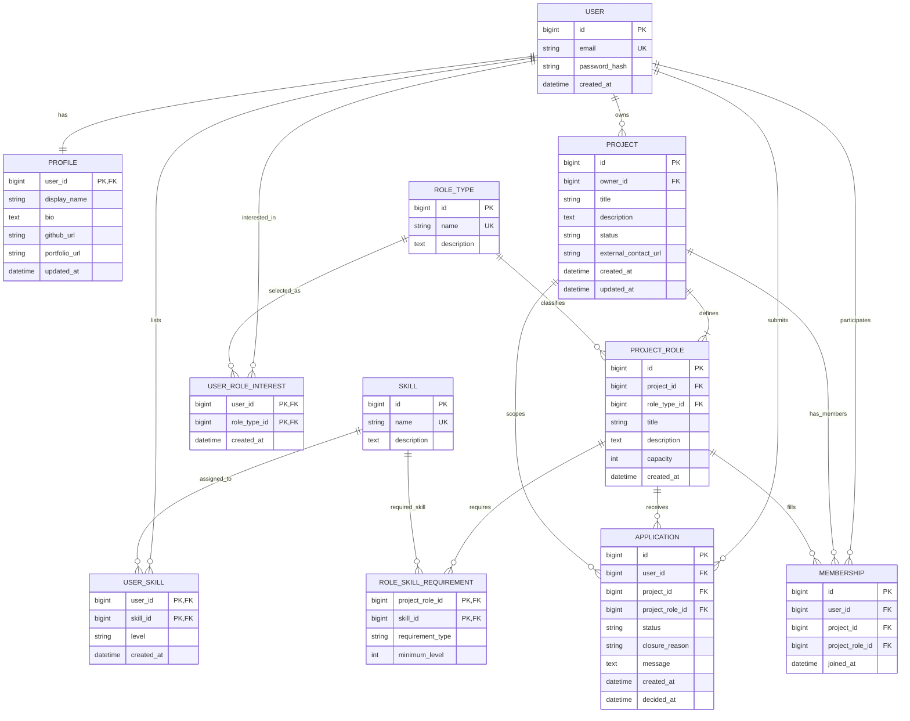

# TeamFinder v1 — ERD и модель данных

**Статус:** Draft — на командное review  
**Основа:** функциональные и бизнес-требования TeamFinder v1; PostgreSQL / EF Core  
**Область:** только сущности и поведение, необходимые для v1.

## 1. Принципиальная ERD



### Кардинальности

- `User` — `Profile`: **1:1**. Профиль принадлежит ровно одному пользователю; `Profile.user_id` одновременно PK и FK.
- `User` — `Skill`: **M:N** через `UserSkill`. Для пары пользователь/навык хранится одна запись.
- `User` — `RoleType`: **M:N** через `UserRoleInterest`. Интерес к одному типу роли не дублируется.
- `User` — `Project`: **1:N** по владению. Каждый проект имеет одного владельца; владелец не считается участником автоматически.
- `Project` — `ProjectRole`: **1:N**. Роль принадлежит одному проекту.
- `ProjectRole` — `Skill`: **M:N** через `RoleSkillRequirement`; для каждой пары роль/навык задаётся один тип требования (`Required` или `NiceToHave`) и, при необходимости, минимальный уровень.
- `User` — `ProjectRole`: **M:N** через `Application` для подачи заявок; одна заявка на пару пользователь/роль за всё время жизни роли.
- `User` — `Project`: **M:N** через `Membership`; не более одного членства пользователя в одном проекте.

## 2. Сущности и поля

Поля ниже — минимальная рекомендуемая схема v1. Имена приведены в стиле PostgreSQL/EF Core; типы уточняются в миграциях.

| Сущность | Основные поля | Ключи и ограничения |
|---|---|---|
| `User` | `id`, `email`, `password_hash`, `created_at` | PK `id`; UNIQUE `email`; пароль хранить только как безопасный хеш. |
| `Profile` | `user_id`, `display_name`, `bio`, `github_url`, `portfolio_url`, `updated_at` | PK и FK `user_id → User.id`; обеспечивает связь 1:1. Поля ссылок могут быть NULL. |
| `Skill` | `id`, `name`, `description` | PK `id`; UNIQUE нормализованного названия `name`. Справочник ведётся командой. |
| `RoleType` | `id`, `name`, `description` | PK `id`; UNIQUE нормализованного `name`. Справочник ведётся командой. |
| `UserSkill` | `user_id`, `skill_id`, `level`, `created_at` | Составной PK (`user_id`, `skill_id`); оба поля — FK; `level` ограничить допустимым набором уровней. |
| `UserRoleInterest` | `user_id`, `role_type_id`, `created_at` | Составной PK (`user_id`, `role_type_id`); оба поля — FK. |
| `Project` | `id`, `owner_id`, `title`, `description`, `status`, `external_contact_url`, `created_at`, `updated_at` | PK `id`; FK `owner_id → User.id`; CHECK статуса. `owner_id` обязателен. |
| `ProjectRole` | `id`, `project_id`, `role_type_id`, `title`, `description`, `capacity`, `created_at` | PK `id`; FK на проект и тип роли; CHECK `capacity > 0`; UNIQUE (`id`, `project_id`) для составных FK. |
| `RoleSkillRequirement` | `project_role_id`, `skill_id`, `requirement_type`, `minimum_level` | Составной PK (`project_role_id`, `skill_id`); FK на роль и навык; CHECK `requirement_type IN ('Required','NiceToHave')`; `minimum_level` NULL либо в допустимом диапазоне. |
| `Application` | `id`, `user_id`, `project_id`, `project_role_id`, `status`, `closure_reason`, `message`, `created_at`, `decided_at` | PK `id`; FK на пользователя; составной FK (`project_role_id`, `project_id`) на роль; UNIQUE (`user_id`, `project_role_id`); CHECK статуса и причины закрытия. |
| `Membership` | `id`, `user_id`, `project_id`, `project_role_id`, `joined_at` | PK `id`; FK на пользователя; составной FK (`project_role_id`, `project_id`) на роль; UNIQUE (`user_id`, `project_id`). |

## 3. PostgreSQL DDL — ключевые ограничения

Это эскиз схемы для согласования модели, а не готовая миграция EF Core. Типы времени указаны как `timestamptz`.

```sql
CREATE TABLE "User" (
    id bigint GENERATED BY DEFAULT AS IDENTITY PRIMARY KEY,
    email text NOT NULL UNIQUE,
    password_hash text NOT NULL,
    created_at timestamptz NOT NULL DEFAULT now()
);

CREATE TABLE profile (
    user_id bigint PRIMARY KEY REFERENCES "User"(id) ON DELETE RESTRICT,
    display_name text NOT NULL,
    bio text,
    github_url text,
    portfolio_url text,
    updated_at timestamptz NOT NULL DEFAULT now()
);

CREATE TABLE skill (
    id bigint GENERATED BY DEFAULT AS IDENTITY PRIMARY KEY,
    name text NOT NULL UNIQUE,
    description text
);

CREATE TABLE role_type (
    id bigint GENERATED BY DEFAULT AS IDENTITY PRIMARY KEY,
    name text NOT NULL UNIQUE,
    description text
);

CREATE TABLE user_skill (
    user_id bigint NOT NULL REFERENCES "User"(id) ON DELETE RESTRICT,
    skill_id bigint NOT NULL REFERENCES skill(id) ON DELETE RESTRICT,
    level text NOT NULL CHECK (level IN ('Beginner','Intermediate','Advanced','Expert')),
    created_at timestamptz NOT NULL DEFAULT now(),
    PRIMARY KEY (user_id, skill_id)
);

CREATE TABLE user_role_interest (
    user_id bigint NOT NULL REFERENCES "User"(id) ON DELETE RESTRICT,
    role_type_id bigint NOT NULL REFERENCES role_type(id) ON DELETE RESTRICT,
    created_at timestamptz NOT NULL DEFAULT now(),
    PRIMARY KEY (user_id, role_type_id)
);

CREATE TABLE project (
    id bigint GENERATED BY DEFAULT AS IDENTITY PRIMARY KEY,
    owner_id bigint NOT NULL REFERENCES "User"(id) ON DELETE RESTRICT,
    title text NOT NULL,
    description text NOT NULL,
    status text NOT NULL CHECK (status IN ('Draft','Recruiting','InProgress','Completed','Cancelled')),
    external_contact_url text,
    created_at timestamptz NOT NULL DEFAULT now(),
    updated_at timestamptz NOT NULL DEFAULT now()
);

CREATE TABLE project_role (
    id bigint GENERATED BY DEFAULT AS IDENTITY PRIMARY KEY,
    project_id bigint NOT NULL REFERENCES project(id) ON DELETE RESTRICT,
    role_type_id bigint NOT NULL REFERENCES role_type(id) ON DELETE RESTRICT,
    title text NOT NULL,
    description text,
    capacity integer NOT NULL CHECK (capacity > 0),
    created_at timestamptz NOT NULL DEFAULT now(),
    UNIQUE (id, project_id)
);

CREATE TABLE role_skill_requirement (
    project_role_id bigint NOT NULL REFERENCES project_role(id) ON DELETE RESTRICT,
    skill_id bigint NOT NULL REFERENCES skill(id) ON DELETE RESTRICT,
    requirement_type text NOT NULL CHECK (requirement_type IN ('Required','NiceToHave')),
    minimum_level text CHECK (minimum_level IS NULL OR minimum_level IN ('Beginner','Intermediate','Advanced','Expert')),
    PRIMARY KEY (project_role_id, skill_id)
);

CREATE TABLE application (
    id bigint GENERATED BY DEFAULT AS IDENTITY PRIMARY KEY,
    user_id bigint NOT NULL REFERENCES "User"(id) ON DELETE RESTRICT,
    project_id bigint NOT NULL REFERENCES project(id) ON DELETE RESTRICT,
    project_role_id bigint NOT NULL,
    status text NOT NULL CHECK (status IN ('Pending','Accepted','Rejected','Withdrawn','Closed')),
    closure_reason text CHECK (closure_reason IS NULL OR closure_reason IN ('AcceptedAnotherRole','RoleFilled','RecruitmentClosed','ProjectCancelled')),
    message text,
    created_at timestamptz NOT NULL DEFAULT now(),
    decided_at timestamptz,
    FOREIGN KEY (project_role_id, project_id) REFERENCES project_role(id, project_id) ON DELETE RESTRICT,
    UNIQUE (user_id, project_role_id),
    CHECK ((status = 'Closed' AND closure_reason IS NOT NULL) OR (status <> 'Closed' AND closure_reason IS NULL))
);

CREATE TABLE membership (
    id bigint GENERATED BY DEFAULT AS IDENTITY PRIMARY KEY,
    user_id bigint NOT NULL REFERENCES "User"(id) ON DELETE RESTRICT,
    project_id bigint NOT NULL REFERENCES project(id) ON DELETE RESTRICT,
    project_role_id bigint NOT NULL,
    joined_at timestamptz NOT NULL DEFAULT now(),
    FOREIGN KEY (project_role_id, project_id) REFERENCES project_role(id, project_id) ON DELETE RESTRICT,
    UNIQUE (user_id, project_id)
);
```

## 4. Бизнес-правила, которые схема должна обеспечивать

1. **Заявка не занимает место.** Количество занятых мест вычисляется по `Membership` для конкретного `ProjectRole`, а не по `Application`.
2. **Не более одной заявки на роль.** UNIQUE (`Application.user_id`, `Application.project_role_id`) запрещает повторную заявку независимо от её конечного статуса.
3. **Не более одного членства в проекте.** UNIQUE (`Membership.user_id`, `Membership.project_id`) запрещает повторное вступление в ту же команду.
4. **Роль должна принадлежать указанному проекту.** Составной FK в `Application` и `Membership` исключает сочетание `project_id` с ролью другого проекта.
5. **Принятие заявки атомарно.** Транзакция должна проверить статус проекта `Recruiting`, статус заявки `Pending`, свободное место, отсутствие членства пользователя в проекте; перевести заявку в `Accepted`, создать `Membership`, закрыть другие `Pending`-заявки пользователя на этот проект с `AcceptedAnotherRole`, а при заполнении роли закрыть оставшиеся `Pending`-заявки роли с `RoleFilled`.
6. **Вместимость роли.** Нельзя создать членство, если число членств по роли достигло `ProjectRole.capacity`. Нужна транзакционная проверка с блокировкой строки роли либо эквивалентная сериализация; обычный `CHECK` не может проверять агрегат по другим строкам.
7. **Закрытие набора/проекта.** При переходе `Recruiting → InProgress` или при отмене проекта все `Pending`-заявки закрываются с причиной `RecruitmentClosed` или `ProjectCancelled`. При завершении проекта подача и принятие заявок запрещены.
8. **Снижение capacity.** Допускается только если новое значение не меньше количества существующих `Membership` этой роли.
9. **Удаление не каскадирует бизнес-историю.** FK используют `ON DELETE RESTRICT`; роль нельзя удалить при наличии связанных заявок/членств. Неявное удаление заявок, участников или проекта запрещено.
10. **Профиль 1:1.** Создание `User` и `Profile` должно согласованно обрабатываться приложением, если профили обязательны после регистрации.
11. **Владение отдельно от членства.** `Project.owner_id` не создаёт запись `Membership` автоматически.

## 5. Ограничения, которые нельзя выразить одними FK/UNIQUE/CHECK

- Вместимость `ProjectRole.capacity` — проверять в сервисе внутри транзакции (или триггером), защищая от одновременного принятия заявок.
- Допустимость подачи/принятия заявки зависит от статуса проекта и роли; проверять при каждой операции в сервисе внутри транзакции.
- При `Application.status = 'Accepted'` должна существовать соответствующая запись `Membership`; это обеспечивается одной транзакцией приложения и проверками целостности. При желании можно дополнить триггером/отложенным constraint trigger.
- Закрытие остальных ожидающих заявок при принятии, заполнении роли или закрытии набора — транзакционная бизнес-операция.
- Значения `level` в DDL — предлагаемая шкала. Согласовать её с командой до реализации; не считать названия уровней окончательными без подтверждения.

## 6. Решения, требующие подтверждения на review

- Подтвердить шкалу навыков `Beginner / Intermediate / Advanced / Expert` и nullable `minimum_level`.
- Подтвердить состав полей профиля и необходимость хранить `external_contact_url` на уровне проекта.
- Подтвердить, что закрытые заявки хранят одну из причин `AcceptedAnotherRole`, `RoleFilled`, `RecruitmentClosed`, `ProjectCancelled`.
- Подтвердить, что `RoleType` используется и для интересов пользователя, и для классификации роли проекта.
- Перед миграцией уточнить точные статусы и правила публикации проекта по требованиям v1.

## 7. Связь с остальными документами

- `teamfinder-v1-requirements.md` — статусы, заявки, вместимость и правила членства.
- `business-requirements.md` — пользовательские сценарии и бизнес-ограничения.
- `architecture-v1.md` — PostgreSQL и Entity Framework Core.

Эта ERD является принципиальной моделью v1 и должна пройти продуктовый/технический review до использования как окончательная схема миграций.