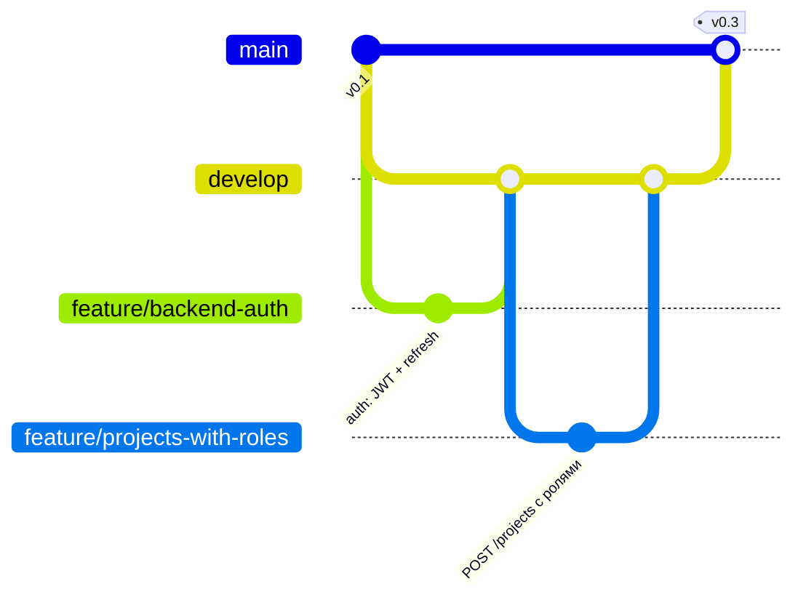

# Работа с Git и GitHub

- Владелец: Участник 1 (Team Lead / DevOps)
- Применяется к: `teamfinder-docs`, `teamfinder-backend`, `teamfinder-frontend`

## 1. Почему меняем процесс

На checkpoint 2 у нас висело несколько веток, которые так и не влили, а часть работы (например, `migration/teamfinder-schema-v2` в backend) вообще осталась мимо `main`. Ветки из worktree тоже лежали отдельно. Договорились так: всё вливаем в `develop` через PR, а в `main` попадает только то, что показываем на checkpoint.

## 2. Ветки



| Ветка | Назначение | Кто пишет |
|---|---|---|
| `main` | Только версии, которые показываем на checkpoint. Защищена: прямой push запрещён | Только merge из `develop` |
| `develop` | Текущая интеграционная ветка. Всегда собирается и проходит тесты | Merge из feature-веток через PR |
| `feature/<коротко-о-задаче>` | Одна задача = одна ветка | Автор задачи |
| `fix/<коротко>` | Исправление ошибки | Автор |
| `docs/<коротко>` | Изменение документации | Автор |

Ветки, созданные через `git worktree` (в том числе агентом), — обычные feature-ветки: они вливаются в `develop` через PR, а потом удаляются. Worktree — это только вторая рабочая папка для той же ветки, а не способ хранить изменения.

### Про слэш в названии ветки

Ветку `feature/backend-auth` git хранит как файл `refs/heads/feature/backend-auth`, то есть `feature` превращается в папку. Отсюда две вещи:

- нельзя одновременно иметь ветку `feature` и ветки `feature/...`: git, а при push и GitHub, откажет с ошибкой `cannot lock ref`. Поэтому ветку с именем просто `feature`, `fix` или `docs` не создаём;
- слэш группирует ветки: GitHub показывает их по префиксу, а правило защиты можно повесить сразу на маску вроде `feature/*`.

Имена пишем так: `тип/коротко-о-задаче`, маленькими латинскими буквами через дефис, например `feature/projects-with-roles`, `fix/withdraw-status`, `docs/api-contracts`.

## 3. Процесс

```text
Issue → Assignee → ветка от develop → коммиты → PR в develop → review → CI зелёный → merge → удалить ветку
```

1. Задача создаётся в GitHub Project как Issue, назначается исполнитель.
2. Ветка создаётся от `develop`: `git switch develop && git pull && git switch -c feature/backend-auth`.
3. Коммиты по смыслу, сообщения в виде `тип: что сделано` (`feat`, `fix`, `docs`, `test`, `refactor`, `ci`).
4. PR в `develop`, в описании — `Closes #<номер issue>` и как проверить.
5. Review делает другой участник. Автор должен уметь объяснить каждое изменение.
6. После merge ветка удаляется (кнопка «Delete branch» в PR).
7. Перед checkpoint: PR `develop → main` и тег версии: `v0.3` для checkpoint 3 (MVP), `v1.0` для защиты.

## 4. Наведение порядка (один раз, перед checkpoint 3)

Выполняет Участник 1.

### teamfinder-backend

```bash
git fetch --all --prune
git switch main && git pull
git switch -c develop && git push -u origin develop

# Не влиты в main: migration/teamfinder-schema-v2 и feature/database-skeleton-integration.
# Их содержимое (тип проекта, история участия, три уровня навыков) полностью вошло
# в новую модель данных checkpoint 3, поэтому ветки закрываются без merge.
# feature/backend-skeleton и feature/initial-postgres-efcore-schema уже влиты (PR #3, #4).
git push origin --delete migration/teamfinder-schema-v2 feature/backend-skeleton \
  feature/database-skeleton-integration feature/initial-postgres-efcore-schema
```

### teamfinder-docs

```bash
git fetch --all --prune
git switch main && git pull
git switch -c develop && git push -u origin develop
# docs/architecture-v1 содержит один невлитый коммит «привести Architecture v1 к единому формату»;
# он заменён новой версией architecture-v1.md, ветку закрываем без merge.
# Остальные docs/* ветки уже влиты (PR #10, #11, #13, #14, #15).
git push origin --delete docs/api-contracts-v1 docs/architecture-v1 docs/business-requirements \
  docs/roadmap-v1 docs/teamfinder-v1-requirements-review docs/ui-design
```

### teamfinder-frontend

```bash
git fetch --all --prune
git switch main && git pull
git switch -c develop && git push -u origin develop
git push origin --delete feature/frontend-skeleton
```

### Настройки GitHub (Settings → Branches)

- Default branch: `develop`.
- Branch protection для `main` и `develop`: Require a pull request before merging, Require approvals: 1, Require status checks to pass: в backend проверка `build-test`, во frontend `build` (они появятся в списке после первого запуска CI).
- Settings → General → Automatically delete head branches: ветка удаляется сама после merge.
- Вкладка Actions: проверить, что GitHub Actions включены, иначе CI не запустится.
