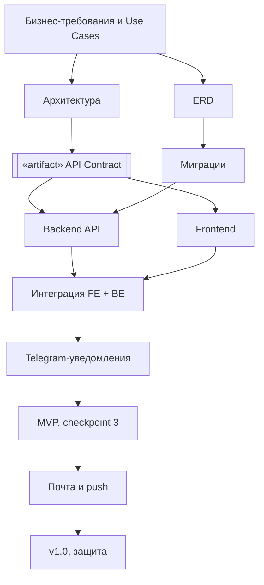

# TeamFinder — Roadmap и план работ

- Версия: 1.1, после checkpoint 2
- Период: сентябрь — декабрь 2026
- Владелец: Участник 1 (Team Lead / Backend / DevOps)
- Reviewer: Участник 2 (Project Manager / System Analyst)

## 1. Цель

Основной сценарий TeamFinder:

регистрация → профиль и навыки → каталог → роль проекта → matching → заявка → решение владельца → команда → уведомление участникам.

## 2. Версии

| Версия | Когда | Что работает | Статус |
|---|---|---|---|
| v0.1 | checkpoint 1, сентябрь | Идея, команда, репозитории на GitHub | ✅ сдано |
| v0.2 | checkpoint 2, октябрь | Документация (требования, сценарии, UI, архитектура, ERD, API), каркасы backend и frontend, схема БД | ✅ сдано, получены замечания |
| v0.3 — MVP | checkpoint 3, 29.10.2026 (сдать до 31.10) | Исправления по замечаниям checkpoint 2. Весь основной сценарий работает в браузере на настоящем backend: вход, профиль, проект с ролями, matching, заявки, команда. Уведомления в сервисе и в Telegram. Демо-данные, запуск через `docker compose up` | в работе |
| v1.0 | защита, декабрь 2026 | MVP + почта и web push, настройки уведомлений, стабилизация | план |

MVP — это рабочая версия TeamFinder, на которой видно, что идея работает: человек находит команду через сервис и узнаёт о решении по заявке в Telegram. v1.0 добавляет к ней остальные каналы и доводит всё до защиты.

Задачи на checkpoint 3 заведены в GitHub Issues: `teamfinder-backend#7`, `teamfinder-frontend#3`, `teamfinder-docs#17`, `teamfinder-docs#18`. В канбане они подписаны «[Checkpoint 2]»: в задании к лабораторным два чекпоинта — лабораторная 2 и лабораторная 3, и это второй из них. В наших документах чекпоинты пронумерованы по лабораторным: checkpoint 3 = лабораторная 3.

## 3. Распределение ответственности

| Участник | Зона ответственности |
|---|---|
| Участник 1 | Backend, архитектура, API Contracts, auth, CI/CD, Docker, интеграция |
| Участник 2 | Модель данных (ERD, миграции), требования и бизнес-правила, планирование, review |
| Участник 3 | Бизнес-анализ, сценарии, UI-дизайн в Figma, frontend |

## 4. План по версиям

### v0.3 — MVP, checkpoint 3 (29.10, сдать до 31.10)

| Задача | Issue | Ответственный | Результат |
|---|---|---|---|
| Исправить API Contracts: auth, проект с ролями, переходы заявок, `DELETE` | — | У1 | `api-contracts-v1.md`, `openapi.yaml` |
| ADR по аутентификации | — | У1 | `adr-001-authentication.md` |
| Архитектура: зависимости, контракт как артефакт, модули, уведомления | — | У1 | `architecture-v1.md` |
| Ветка `develop`, закрыть старые ветки | — | У1 | `git-workflow.md` |
| Backend: auth, текущий пользователь, профиль, проекты, matching, заявки, команда, Swagger с авторизацией | backend#7 | У1 + У2 | endpoint'ы контракта |
| Telegram-уведомления: привязка по ссылке, отправка | backend#7 | У1 | модуль `Notifications/Telegram` |
| ERD и миграция по новой модели | backend#7 | У2 | `erd-v1.md`, `Migrations/` |
| Бизнес-правила одним документом | — | У2 | `business-rules.md` |
| Тесты бизнес-правил | backend#7 | У2 | `tests/TeamFinder.Api.Tests` |
| Демо-данные и материалы показа, проверка UC-01…UC-18 | docs#18 | У2 | `demo-guide.md`, `DemoDataSeeder` |
| Frontend: все экраны S-01…S-10 на реальном API, подтверждения, Telegram в профиле | frontend#3 | У3 | экраны работают с backend |
| UI-дизайн: S-05 с ролями, модалка S-04a, состояния экранов | docs#17 | У3 | Figma + `ui/`, `ui-design.md` |
| Бизнес-требования и сценарии под новый API | — | У3 | `business-requirements.md`, `use-cases.md` |
| Docker Compose: frontend + API + PostgreSQL | — | У1 | `docker-compose.yml` |
| Прогон показа по `demo-guide.md` всеми участниками | docs#18 | Все | заполненная таблица проверки |

### v1.0 — защита (декабрь)

| Задача | Ответственный |
|---|---|
| Email через SMTP | У2 |
| Восстановление пароля по почте (если успеваем, вместе с SMTP) | У1 |
| Web push: подписка в браузере, Service Worker | У3 |
| Настройки уведомлений: какие события и в какие каналы | У1 + У3 |
| Сортировка каталога по соответствию навыков | У1 |
| Стабилизация, исправление ошибок, финальная документация | Все |
| Подготовка защиты: кто какую часть рассказывает | Все |

## 5. Зависимости

Стрелка «A → B» здесь значит «B начинается после A». Frontend и backend зависят от контракта, а не друг от друга, поэтому их можно делать параллельно: frontend работает по контракту на тестовых данных, пока backend не готов.

## 6. Контрольные точки

| Контрольная точка | Когда | Что показываем |
|---|---|---|
| Checkpoint 1 (лабораторная 1) | сентябрь | v0.1: команда, тема, GitHub-проект |
| Checkpoint 2 (лабораторная 2) | октябрь | v0.2: качество GitHub и веток, анализ задачи, первичный дизайн, ERD, Hello World-проекты, график работ и roadmap, контракты, бизнес-требования |
| Checkpoint 3 (лабораторная 3) | 29.10.2026, сдать до 31.10 | v0.3 — MVP: первый показ работы приложения по `demo-guide.md`, ревью кода, документация, сверка достижимости roadmap (раздел 8), все положительные сценарии, завершённый дизайн |
| Защита | декабрь 2026 | v1.0 |

## 7. Риски

| Риск | Что делаем |
|---|---|
| Участник не может объяснить, как работает часть, сделанная с помощью ИИ | Каждый PR проверяет второй участник; автор на review объясняет изменения. Перед checkpoint — прогон вопросов из `defense-notes.md` и показа по `demo-guide.md` |
| Frontend ждёт backend | Работа по контракту, тестовые данные на frontend |
| Расхождение документации и кода | Контракт правится первым; Swagger показывает контракт и реализацию рядом |
| Несмерженные ветки | Ветка живёт не дольше недели, PR в `develop` с review |
| Не успеть к 29.10 | Сначала основной сценарий и показ (backend#7, frontend#3, docs#18), Telegram — следующим, Figma — параллельно, но до 29.10: завершённый дизайн — требование лабораторной 3 |

## 8. Сверка достижимости (на 20.10.2026)

На лабораторной 3 преподаватель смотрит, успеваем ли мы по roadmap. Где мы сейчас по задачам v0.3:

| Задача | Состояние | Что осталось до 29.10 |
|---|---|---|
| Исправления контракта, ADR, архитектура, бизнес-правила | готово | перенести в GitHub через PR |
| Backend: все endpoint'ы контракта, Telegram, демо-данные, 32 теста (backend#7) | код написан | собрать, сгенерировать миграцию, прогнать тесты |
| Frontend: экраны S-01…S-10 (frontend#3) | код написан, сборка проходит | проверить вместе с backend |
| Docker Compose: база + API + frontend | готово | запустить на чистой машине |
| Показ и проверка UC (docs#18) | `demo-guide.md` и демо-данные готовы | пройти сценарий, заполнить таблицу проверки |
| UI-дизайн (docs#17) | описание экранов и состояний готово | макеты в Figma: S-05 с ролями, модалка S-04a, обводки, PNG в `ui/` |
| Ветки `develop` / `main` | описано в `git-workflow.md` | сделать в GitHub |

К 29.10 успеваем: код и документы готовы, осталось проверить всё вживую, перенести через PR и доделать макеты. v1.0 к декабрю тоже выглядит реально, потому что почта и push подключаются к уже готовой отправке уведомлений, заявки и команду переделывать не придётся.
