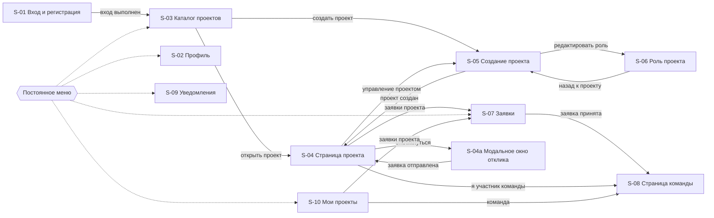

# TeamFinder — UI-дизайн v1

- Версия: 1.1, после checkpoint 2
- Владелец: Участник 3 (Frontend / Designer / BA)
- Reviewer: Участник 1 (Team Lead / Backend)
- Связанные документы: `use-cases.md`, `business-rules.md`, `teamfinder-v1-requirements.md`, `api-contracts-v1.md`
- Макет: https://www.figma.com/design/Q44zk3J1QJNeWsQDKUcoNT (файл «TeamFinder UI v1»)
- Экспорт экранов: `ui/` в этом репозитории

---

## 1. Назначение документа

Документ описывает состав экранов первой версии TeamFinder, содержимое каждого экрана, переходы между ними и ключевые пользовательские действия. Служит связкой между сценариями использования и будущей реализацией frontend.

Уровень проработки — низкая детализация: структура экрана и состав элементов. Цветовая схема, типографика и компонентная библиотека в первой версии не фиксируются.

---

## 2. Состав экранов

| ID | Экран | Доступ | Сценарии |
|---|---|---|---|
| S-01 | Вход и регистрация | гость | UC-01, UC-02 |
| S-02 | Профиль пользователя | авторизованный | UC-03 |
| S-03 | Каталог проектов | авторизованный | UC-06 |
| S-04 | Страница проекта | авторизованный | UC-07, UC-08 |
| S-05 | Создание и редактирование проекта | владелец | UC-04, UC-05, UC-15, UC-16 |
| S-06 | Редактирование роли проекта | владелец | UC-05 |
| S-07 | Заявки | автор заявки и владелец | UC-09, UC-10, UC-11, UC-12 |
| S-08 | Страница команды | владелец и участники | UC-13, UC-14 |
| S-04a | Модальное окно «Откликнуться» | кандидат | UC-08 |
| S-09 | Уведомления (выпадающий список в шапке) | авторизованный | UC-17 |
| S-10 | Мои проекты | авторизованный | UC-10, UC-13, UC-14 (переходы) |

---

## 3. Карта переходов

Верхняя цепочка — основной путь кандидата: вход, каталог, проект, заявка. После отправки заявки кандидат остаётся на странице проекта, а свои заявки открывает из меню (S-07). Ответвления вниз — действия владельца проекта: создание проекта, управление им (S-05, там же добавляются роли) и редактирование отдельной роли (S-06).

Сплошные стрелки — переходы по действию пользователя, пунктирные — навигация через постоянное меню. Меню доступно на всех экранах кроме S-01: каталог, мои заявки, мои проекты, профиль, уведомления, выход.

---

## 4. Описание экранов

### S-01. Вход и регистрация

Назначение: получить доступ к системе.

Состав:

- переключатель между формой входа и формой регистрации;
- поля email и пароля;
- для регистрации — ещё имя и подтверждение пароля;
- кнопка действия;
- область вывода ошибок формы.

Действия: войти, зарегистрироваться.

Состояния: обычное, отправка запроса, ошибка валидации полей, ошибка входа.

Особенности: при неверных данных входа показывается общее сообщение, без уточнения, какое поле неверно (FR-AUTH-07). После регистрации пользователь сразу авторизуется и попадает на S-02.

---

### S-02. Профиль пользователя

Назначение: заполнить данные, на основании которых работает сопоставление.

Состав:

- имя и краткая информация о себе;
- блок «Интересующие роли»: выбор типов ролей из справочника;
- блок «Навыки»: список добавленных навыков, у каждого — уровень (начинающий, средний, продвинутый) и кнопка удаления;
- форма добавления навыка: выбор из справочника плюс выбор уровня;
- кнопка сохранения;
- ссылки на GitHub и на портфолио (два необязательных поля);
- блок «Уведомления в Telegram» (UC-18): если не подключено — кнопка «Подключить Telegram»; после нажатия — ссылка на бота, подсказка «Откройте ссылку и нажмите Start, ссылка действует 10 минут» и кнопка «Проверить»; если подключено — «Подключено с <даты>» и кнопка «Отключить»; если бот не настроен на сервере — серая подпись «Telegram недоступен».

Данные: User, Profile, UserSkill, UserRoleInterest, справочники Skill и RoleType; статус Telegram (`GET /api/profile/telegram`).

Действия: сохранить профиль, добавить навык, изменить уровень, удалить навык, добавить и удалить интересующую роль.

Состояния: загрузка справочников, пустой профиль, ошибка сохранения.

Особенности: навык, уже добавленный в профиль, не должен предлагаться повторно в списке выбора (RULE-PROF-02). Незаполненный профиль — не ошибка, но на S-04 вместо разбора соответствия будет «В профиле нет навыков — сравнивать не с чем», поэтому на S-02 стоит подсказка, зачем заполнять навыки.

---

### S-03. Каталог проектов

Назначение: поиск подходящего проекта.

Состав:

- поиск по названию и описанию;
- панель фильтров: тип роли, навык, тип проекта, переключатель «только открытый набор»;
- кнопка сброса фильтров;
- список карточек проектов, по 10 на странице, кнопки «Назад» и «Вперёд».

Карточка проекта: название, тип проекта, состояние проекта, краткое описание, роли с заполненностью в формате «принято / всего мест». Закрытые роли показаны серым.

Данные: Project, ProjectRole, Membership (для подсчёта занятых мест).

Действия: применить фильтр, сбросить фильтры, открыть проект, перейти к созданию проекта.

Состояния: загрузка, пустой результат с подсказкой изменить фильтры, ошибка загрузки.

Особенности: проекты в состоянии «черновик» в каталоге не показываются (FR-CAT-07). Фильтры комбинируются, при смене фильтра список начинается с первой страницы.

---

### S-04. Страница проекта

Назначение: изучить проект, оценить соответствие и подать заявку. Для владельца — управлять проектом.

Состав:

- шапка: название, тип проекта, состояние проекта, описание, владелец;
- список ролей проекта, для каждой роли:
  - тип роли и описание;
  - заполненность «принято / всего мест»;
  - обязательные навыки с минимальным уровнем, если задан;
  - желательные навыки;
  - блок соответствия;
  - кнопка «Откликнуться».

Блок соответствия (ключевой элемент экрана): по каждому обязательному навыку — есть ли он у пользователя и достаточен ли уровень; по каждому желательному — есть или нет; итог в виде «совпало N из M обязательных, K из L желательных»; отметка, совпадает ли тип роли с интересующими ролями пользователя. Процент соответствия не показывается (RULE-MATCH-06).

Данные: Project, ProjectRole, RoleSkillRequirement, UserSkill, UserRoleInterest, Application (для определения, подавал ли пользователь заявку).

Действия для кандидата: откликнуться на роль, перейти к своим заявкам.
Действия для владельца: редактировать проект, добавить роль, редактировать роль, перейти к заявкам проекта, сменить состояние проекта.
Действия для участника команды: перейти на страницу команды.

Состояния кнопки «Откликнуться»:

| Условие | Вид кнопки | Правило |
|---|---|---|
| Проект не в наборе | отключена, подпись «Набор закрыт» | RULE-LIFE-03 |
| Все места роли заняты | отключена, подпись «Мест нет» | RULE-ROLE-10 |
| Заявка уже подана | отключена, подпись «Заявка подана», рядом статус заявки | RULE-APP-02 |
| Пользователь уже в команде проекта | отключена, подпись «Вы в команде» | RULE-APP-08 |
| Роль закрыта владельцем | отключена, подпись «Роль закрыта» | RULE-ROLE-09 |
| Пользователь — владелец | скрыта | RULE-APP-06 |
| Иначе | активна | — |

Особенности: отключение кнопки — только удобство, проверка выполняется на сервере в любом случае (FR-UX-02). Нажатие открывает модальное окно S-04a.

---

### S-04a. Модальное окно «Откликнуться»

Назначение: подтвердить отклик на конкретную роль и добавить комментарий.

Состав:

- заголовок «Отклик на роль», под ним название проекта и роли;
- краткий итог соответствия: «2 из 2 обязательных · 1 из 2 желательных», недостающие навыки списком;
- если в профиле нет навыков — подсказка «Заполните навыки в профиле, чтобы владелец видел соответствие» со ссылкой на S-02 (заявку подать всё равно можно);
- поле «Комментарий для владельца» (необязательное, до 1000 символов, счётчик);
- кнопки «Отправить заявку» и «Отмена».

Запрос: `POST /api/projects/{projectId}/roles/{roleId}/applications`.

Состояния: обычное, отправка (кнопка заблокирована, «Отправка…»), ошибка бизнес-правила (текст `message` от сервера над кнопками, например «Все места на этой роли уже заняты»), успех — окно закрывается, у роли появляется метка «Ожидает решения», кнопка меняется на отключённую «Заявка подана».

---

### S-05. Создание и редактирование проекта

Назначение: завести проект вместе с командой, которую он ищет, и управлять его параметрами.

Экран работает в двух режимах.

#### Режим «Создание»

Одна форма, один запрос `POST /api/projects` (RULE-PROJ-01):

- поле названия;
- поле описания;
- выбор типа проекта: pet-проект, хакатон, учебный проект;
- поле внешнего контакта команды (необязательное, ссылка вида `https://t.me/...`);
- блок «Роли проекта»: список карточек ролей. В каждой карточке:
  - тип роли — выпадающий список из справочника (RULE-ROLE-04);
  - уточнение названия (необязательно);
  - описание;
  - количество мест (1–50);
  - обязательные навыки: навык из справочника + минимальный уровень (необязательно);
  - желательные навыки: навык из справочника;
  - кнопка «Удалить роль» (удаляет карточку из формы, на сервер ничего не уходит);
- кнопка «+ Добавить роль» — добавляет пустую карточку;
- переключатель «Сразу открыть набор» (`publish: true`), доступен, если есть хотя бы одна роль;
- кнопка «Создать проект».

Блока состояния и кнопок переходов в режиме создания нет: проекта ещё не существует.

Ошибки валидации показываются у конкретного поля, в том числе внутри карточки роли (сервер возвращает путь поля, например `roles[1].capacity`).

После создания открывается страница проекта S-04.

#### Режим «Редактирование»

- поля проекта (название, описание, внешний контакт; тип — только в черновике) — сохраняются `PATCH /api/projects/{id}`;
- блок управления состоянием: текущее состояние и только допустимые переходы (RULE-LIFE-04). Перевод в работу и отмена требуют подтверждения, так как закрывают все ожидающие заявки (RULE-APP-07);
- список ролей с заполненностью «занято / всего» и кнопками «Редактировать» (S-06) и «+ Добавить роль».

Данные: Project, ProjectRole, RoleSkillRequirement, справочники Skill и RoleType.

Состояния: создание, редактирование, отправка, ошибка валидации, подтверждение необратимого перехода.

---

### S-06. Редактирование роли проекта

Назначение: поменять уже созданную роль. Новые роли добавляются на S-05: при создании проекта или кнопкой «+ Добавить роль» в режиме редактирования. Поля те же.

Состав:

- выбор типа роли из справочника;
- уточнение названия (необязательно);
- поле описания;
- поле количества мест;
- блок обязательных навыков: выбор навыка и, при необходимости, минимального уровня;
- блок желательных навыков;
- кнопки «Сохранить», «Закрыть роль» и «Удалить роль». Если на роль уже подавали заявки, «Удалить роль» отключена с подписью «Удалить нельзя: на роль уже подавали заявки». У закрытой роли вместо «Закрыть роль» — отключённая «Роль закрыта».

Данные: ProjectRole, RoleSkillRequirement, справочники Skill и RoleType.

Действия: сохранить изменения, добавить и удалить требование к навыку, закрыть роль (`POST .../roles/{roleId}/close`), удалить роль без заявок.

Состояния:

- роль без заявок — редактируются все поля;
- роль с заявками — тип роли и требования к навыкам заблокированы, редактируются только название, описание и количество мест, рядом поясняющая подпись (RULE-ROLE-06);
- ошибка валидации.

Особенности: количество мест не может быть меньше одного и не может быть уменьшено ниже числа принятых участников (RULE-ROLE-01, RULE-ROLE-08). Один навык нельзя выбрать одновременно обязательным и желательным (RULE-ROLE-02). Роль без обязательных навыков допустима (RULE-ROLE-03).

---

### S-07. Заявки

Экран с двумя режимами. Режим определяется тем, откуда пользователь пришёл.

#### Режим «Мои заявки»

Состав: список заявок пользователя, в каждой строке — название проекта, роль, дата подачи, статус, кнопка отзыва.

Статусы: ожидает решения, принята, отклонена, отозвана, закрыта.

Действия: отозвать заявку, перейти к проекту, перейти на страницу команды для принятой заявки.

Особенности: кнопка отзыва активна только для заявок в статусе «ожидает решения», у остальных она отключена (RULE-APP-03, FR-UX-01). Для закрытой заявки рядом со статусом показывается причина закрытия.

#### Режим «Заявки проекта»

Состав: заявки, сгруппированные по ролям проекта; заголовок группы показывает заполненность роли. Карточка заявки: имя кандидата, информация о себе, навыки с уровнями, интересующие роли, комментарий к заявке, блок соответствия, статус, кнопки «Принять» и «Отклонить».

Данные: Application, Profile, UserSkill, ProjectRole, Membership.

Действия: принять кандидата, отклонить кандидата, открыть GitHub кандидата, если он указан. Отдельной страницы профиля кандидата нет: всё нужное для решения показано прямо в карточке заявки.

Особенности: при отсутствии свободных мест кнопка «Принять» отключается, но сервер всё равно проверяет ограничение (RULE-CAP-02, RULE-CAP-03). Если при попытке принять возвращается ошибка заполненности роли, экран показывает сообщение и обновляет данные. Принятие необратимо, поэтому перед ним показывается окно подтверждения.

Состояния обоих режимов: загрузка, пустой список, ошибка.

---

### S-08. Страница команды

Назначение: показать сформированную команду и способ связи.

Состав:

- название проекта и его состояние;
- список участников: имя, роль в проекте;
- внешний контакт команды;
- кнопка «Выйти из команды» для участника;
- кнопка исключения рядом с каждым участником для владельца.

Данные: Project, Membership, ProjectRole, User.

Действия: выйти из команды, исключить участника, перейти к проекту.

Состояния: команда пуста, ошибка, подтверждение выхода или исключения.

Особенности: внешний контакт виден только владельцу и действующим участникам (RULE-TEAM-07). Выход и исключение требуют подтверждения; после них доступ к экрану пропадает (RULE-TEAM-04). Если внешний контакт не указан, блок показывает соответствующую подпись.

---

### S-09. Уведомления

Назначение: сообщить пользователю о событиях без ручной проверки статусов.

Состав: колокольчик в шапке с числом непрочитанных; по нажатию — выпадающий список: текст уведомления, время, ссылка на проект. Кнопка «Прочитать все». Открытое уведомление отмечается прочитанным, новые подсвечены. Список обновляется раз в 30 секунд.

Данные: `GET /api/notifications`, `POST /api/notifications/{id}/read`, `POST /api/notifications/read-all`.

Те же уведомления приходят в Telegram, если пользователь подключил бота в профиле (S-02, UC-18). Push и письма на почту — в v1.0.

---

### S-10. Мои проекты

Назначение: быстро попасть в свои проекты — те, где пользователь владелец, и те, где он в команде.

Состав: список карточек. В карточке название, тип и состояние проекта, метка «Владелец» или «Участник», роли с заполненностью «занято / всего». Ссылки: для владельца «Управление» (S-05) и «Заявки» (S-07) с числом новых заявок, например «Заявки (новых: 2)»; для всех, кроме черновика, «Команда» (S-08).

Данные: `GET /api/projects/mine` (поля `myRelation` и `pendingApplications`).

Состояния: загрузка, пусто («Вы пока не создали проект и не состоите в команде»), ошибка.

Особенности: черновики видит только владелец. Число новых заявок закрывает требование BR-26.

---

## 5. Общие правила интерфейса

| Правило | Обоснование |
|---|---|
| Каждый экран со списком имеет три состояния: загрузка, пустой результат, ошибка | FR-UX-03 |
| Недоступное по бизнес-правилу действие отключается, а не скрывается, и сопровождается подписью с причиной. Не показываются только действия чужой роли: владельцу — «Откликнуться», кандидату — кнопки управления проектом | FR-UX-01 |
| Отключение элемента не заменяет проверку на сервере | FR-UX-02 |
| Необратимые действия подтверждаются: принятие кандидата, исключение, выход из команды, перевод проекта в работу, завершение и отмена. Подтверждение — своё модальное окно в стиле приложения, а не системный `confirm()` браузера | RULE-APP-07, RULE-TEAM-04 |
| Ошибка бизнес-правила показывается понятным текстом, а не техническим кодом | FR-UX-04 |
| Заполненность роли везде отображается единообразно: «принято / всего мест» | FR-ROLE-07 |
| Все карточки и секции — белый фон, обводка 1px `#E5E7EB`, скругление 12px. Заголовки страниц и строки с кнопками лежат прямо на сером фоне страницы, без белой подложки | — |

---

## 5a. Матрица состояний экранов

Задача `teamfinder-docs#17`. Для каждого экрана: что показывается при загрузке, пустых данных, ошибке и неверном вводе, какие действия требуют подтверждения и что видят разные пользователи. Frontend сверяется с этой таблицей.

### Состояния

Общие для всех экранов со списками (компонент `RequestState`):

- загрузка — индикатор и «Загрузка…»;
- ошибка загрузки — «Не удалось загрузить данные», под ним текст `message` от сервера (например «Проект не найден») и кнопка «Повторить»;
- пусто — текст, свой для каждого экрана (ниже), и кнопка «Обновить»;
- ошибка правила при действии — плашка с текстом `message` от сервера над кнопками, без кода ошибки;
- ошибка валидации — текст под конкретным полем по пути из `errors` (`githubUrl`, `roles[1].capacity`);
- подтверждение — своё модальное окно с текстом последствий и кнопкой действия.

| Экран | Отправка | Пусто | Ошибки, которые показываем | Подтверждение |
|---|---|---|---|---|
| S-01 Вход / регистрация | «Подождите…» | — | у полей; неверный пароль — «Неверный email или пароль»; `429` — «Слишком много попыток входа…» | — |
| S-02 Профиль | «Сохраняем…» | «Добавьте навыки — по ним считается соответствие ролям проектов» | у полей (`githubUrl`, `skills[0].level`); Telegram не настроен на сервере — `TELEGRAM_DISABLED` | отключение Telegram |
| S-03 Каталог | — | «Под фильтры ничего не подошло — попробуйте изменить условия» | ошибка загрузки | — |
| S-04 Проект | — | «В проекте пока нет ролей»; у роли без навыков — «Требований к навыкам нет» | `404` — «Проект не найден» (черновик чужого проекта тоже `404`) | — |
| S-04a Отклик | «Отправка…» | нет навыков — подсказка со ссылкой на профиль | `ROLE_FULL`, `DUPLICATE_APPLICATION`, `PROJECT_NOT_RECRUITING` | — |
| S-05 Создание проекта | «Создаём…» | «Роли можно добавить и позже, но открыть набор без ролей нельзя» | у полей, в том числе внутри карточки роли (`roles[1].capacity`) | — |
| S-05 Управление проектом | на время запроса кнопки отключены | у ролей без требований — «Не указаны» | `INVALID_STATE_TRANSITION`, `PROJECT_HAS_NO_ROLES` | перевод в работу, завершение, отмена |
| S-06 Роль | на время запроса кнопки отключены | «Не указаны» | `ROLE_LOCKED` (тип и навыки заблокированы, рядом подпись), `ROLE_HAS_APPLICATIONS` при удалении, `CAPACITY_BELOW_OCCUPIED` | закрытие и удаление роли |
| S-07 Мои заявки | на время запроса кнопка отключена | «Вы ещё не подавали заявок. Найдите проект в каталоге» | `APPLICATION_NOT_PENDING` — сообщение, список обновляется | отзыв |
| S-07 Заявки проекта | на время запроса кнопки отключены | «Заявок нет» | `403` — «Нет доступа»; `ROLE_FULL` — сообщение, данные обновляются | принятие |
| S-08 Команда | на время запроса кнопки отключены | «В команде пока никого нет» | `403` — «Нет доступа»; `PROJECT_NOT_EDITABLE` | выход, исключение |
| S-09 Уведомления | — | «Пока уведомлений нет» | при ошибке колокольчик остаётся без счётчика | — |
| S-10 Мои проекты | — | «Вы пока не создали проект и не состоите в команде» | ошибка загрузки | — |

### Что видит каждый пользователь

| Экран | Гость | Кандидат | Владелец | Участник команды |
|---|---|---|---|---|
| S-03 Каталог | переход на S-01 | проекты кроме черновиков, фильтры, «+ Создать проект» (создать проект может любой) | то же | то же |
| S-04 Проект | переход на S-01 | роли, блок соответствия, кнопка «Откликнуться» в одном из состояний таблицы выше | «Управление проектом», «Заявки проекта», «Страница команды»; кнопки «Откликнуться» нет | роли, «Страница команды», на кнопке «Вы в команде» |
| S-05, S-06 Редактирование | переход на S-01 | `403` | все поля и переходы состояния | `403` |
| S-07 Заявки проекта | переход на S-01 | `403` | все заявки проекта, «Принять» / «Отклонить» у ожидающих | `403` |
| S-08 Команда | переход на S-01 | `403` | состав, внешний контакт, «Исключить» у каждого | состав, внешний контакт, «Выйти из команды» |
| S-10 Мои проекты | переход на S-01 | пусто, если нет своих проектов | свои проекты, «Управление», «Заявки (новых: N)», «Команда» | проекты, где он в команде, «Команда» |

Для завершённого или отменённого проекта кнопки изменений отключены у всех, страница остаётся доступной для просмотра.

---

## 6. Соответствие сценариям

| Сценарий | Экран |
|---|---|
| UC-01 Регистрация | S-01 |
| UC-02 Вход | S-01 |
| UC-03 Редактирование профиля | S-02 |
| UC-04 Создание проекта (вместе с ролями) | S-05 |
| UC-05 Создание роли проекта | S-05 (добавление), S-06 (изменение) |
| UC-06 Просмотр каталога | S-03 |
| UC-07 Просмотр соответствия | S-04 |
| UC-08 Подача заявки | S-04, S-04a |
| UC-09 Отзыв заявки | S-07 |
| UC-10 Просмотр заявок проекта | S-07 |
| UC-11 Принятие заявки | S-07 |
| UC-12 Отклонение заявки | S-07 |
| UC-13 Выход из команды | S-08 |
| UC-14 Исключение участника | S-08 |
| UC-15 Перевод проекта в работу | S-05 |
| UC-16 Завершение и отмена проекта | S-05 |
| UC-17 Просмотр уведомлений | S-09 |
| UC-18 Подключение Telegram | S-02 |

Все восемнадцать сценариев покрыты экранами. Экран S-10 «Мои проекты» — вспомогательный: с него владелец и участники переходят к заявкам и команде.
